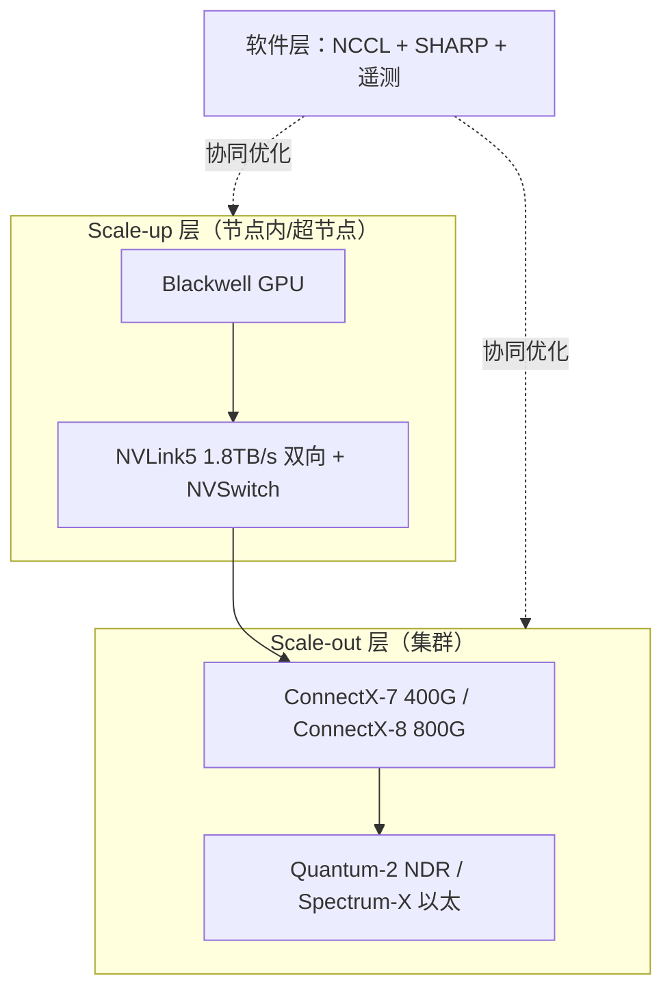

# NVIDIA 网络全栈

> 中文简称：NVIDIA 网络全栈

> **一句话理解**: NVIDIA 是唯一一家从节点内互连、交换机、网卡到通信软件全部自研并协同优化的公司——全栈性能上限最高，被锁定得也最深。

---

## 一、全栈版图：四层全覆盖的唯一玩家

GPU 高性能网络可以切成四层：节点内/超节点互连（scale-up）、集群交换网（scale-out）、主机侧网卡/DPU、通信与在网计算软件。多数厂家只覆盖一到两层——Broadcom 只做交换芯片、Marvell 主攻光 DSP 与定制芯片、Cisco 做商用整机——NVIDIA 是目前唯一四层都有量产拳头产品的玩家。

全栈的直接收益是跨层协同：NVLink 的拓扑信息可以被 NCCL 感知，AllReduce 的聚合可以下沉到 Quantum 交换机执行（SHARP），Spectrum-X 的自适应路由可以消费 ConnectX 网卡的逐流遥测。这些联动在拼装式方案里要么做不到，要么要靠用户自己做大量集成工作。

也要看到边界：全栈不等于每一层都份额第一——在通用以太交换芯片市场上 Broadcom 仍是绝对统治者。NVIDIA 的优势是"四层拼起来后的整体性能"，而不是单点碾压。



图：NVIDIA 全栈四层互相咬合——互连、交换机、网卡、软件任何一层的升级都会同步其他三层。这是性能优势的来源，也是锁定的来源。

---

## 二、产品矩阵：互连、交换机、网卡、软件

**表：NVIDIA 网络产品矩阵（2026 口径）**

| 层 | 产品线 | 关键规格 | 角色 |
| --- | --- | --- | --- |
| **节点内互连** | NVLink4 / NVLink5 + NVSwitch | NVLink4 900GB/s、NVLink5 1.8TB/s（双向口径） | GPU 间 scale-up |
| **IB 交换机** | Quantum-2 / Quantum-X800 | NDR 400G / XDR 800G | 专用无损计算网 |
| **以太交换机** | Spectrum-3 / Spectrum-X800 | Spectrum-3 51.2T；X800 对应 800G 端口世代 | AI 以太网与通用负载 |
| **网卡 / DPU** | ConnectX-7 / ConnectX-8 / BlueField-3 | 400G / 800G / DPU 卸载 | 主机侧接入与卸载 |
| **软件** | NCCL / SHARP / Spectrum-X 软件栈 | 自适应路由 + 逐流遥测 | 全栈的粘合剂 |

注：带宽数字为厂商公开口径；NVLink 带宽按每 GPU 双向聚合计，IB/以太端口速率为单向线速。

---

## 三、Mellanox 收购：一笔交易奠定网络霸权

- 2019 年 3 月，NVIDIA 宣布以约 69 亿美元收购以色列 Mellanox，是当时公司史上最大一笔收购；2020 年 4 月完成交割。
- Mellanox 带来的不只是 InfiniBand 交换机与 ConnectX 网卡，还有 RoCE 以太方案、线缆光模块业务与一批网络软件人才。
- 收购前 IB 市场尚有 Intel Omni-Path 等对手；收购后 NVIDIA 成为 IB 事实上的唯一供应商，IB 从"开放生态之一"变成 NVIDIA 的私有武器。
- 时间点极为关键：交割完成约两年后大模型训练爆发，GPU + IB + NCCL 成为默认答案，网络从边缘配件变成战略核心业务。
- 收购后 Mellanox 以 NVIDIA Networking 事业部形态运营，Quantum/Spectrum/ConnectX 产品线品牌延续至今。

这段历史的选型启示：互连路线的控制权可以在一次并购内易主。评估任何网络技术时，除了当下性能，还要问"这条路线的标准制定权、供应与定价权在谁手里"。

---

## 四、软件护城河：NCCL、SHARP 与 Spectrum-X

硬件可以被追赶，跨层软件协同才是更深的护城河：

- **NCCL**：GPU 集合通信的事实标准库，与 CUDA、GPUDirect 深度绑定，对 NVIDIA 自家互连永远有最优先的适配路径。
- **SHARP**：在网计算协议，把 AllReduce/AllGather 的聚合动作下沉到 Quantum 交换机执行，减少数据在网卡与 GPU 间的来回搬运，大模型训练收益显著。
- **Spectrum-X**：以太网上的"类 IB"方案——自适应路由（逐流绕开拥塞）+ 网卡侧遥测闭环，主打可预期的低尾延迟，直接对标标准 RoCE 与 UEC 路线。

```bash
# 全栈组合下 NCCL 的典型调优入口（详见 NCCL 调优页）
export NCCL_IB_HCA=mlx5_0:1,mlx5_1:1,mlx5_2:1,mlx5_3:1  # 绑定 4 张 ConnectX 网卡
export NCCL_SOCKET_IFNAME=eth0                          # 带外管理网
export NCCL_DEBUG=INFO                                  # 组网验证阶段必开
```

---

## 五、商业模式：全栈协同与深度锁定的一体两面

**表：NVIDIA 全栈路线 vs 白盒/商用芯片路线**

| 维度 | NVIDIA 全栈（IB / Spectrum-X） | 白盒 + 商用芯片 |
| --- | --- | --- |
| **性能上限** | 跨层联合优化，尾延迟可控 | 依赖集成能力，靠运营补齐 |
| **成本** | 溢价明显（整机 + 专用线缆 + 许可） | 硬件成本低，人力成本高 |
| **供应** | 单一来源 | 多源（Broadcom / Marvell / 多家 ODM） |
| **退出成本** | 高：调优遗产、线缆规格、运维体系全绑定 | 低：换 NOS 或芯片影响面小 |

IB 的商业模式尤其"整机化"：交换机、线缆、网卡乃至软件许可打包销售，并通过认证体系约束整机厂与集成商。全栈协同的技术优势与深度锁定是同一枚硬币的两面——协同点越多，可替换的切分面越少。

---

## 六、NVLink Fusion 开放化与采购方启示

Computex 2025 上 NVIDIA 推出 NVLink Fusion，向第三方 CPU、ASIC 与网卡厂商授权 NVLink 互连，MediaTek、Marvell 等为首批合作伙伴。战略意图可拆成三层：

1. **防守开放阵营**：UALink 联盟集结了 AMD、Broadcom 等几乎所有非 NVIDIA 势力，与其被开放标准围攻，不如把 NVLink 变成可授权的"半开放"生态。
2. **扩大接入面**：让自研 ASIC 的云厂商、定制 CPU/网卡的厂商也能接入 NVSwitch 机架体系，NVLink 从"只连自家芯片"变成"可连别人的芯片"。
3. **控制授权边界**：谁能接入、接入到哪一层、授权费怎么收，决定权仍在 NVIDIA——开放程度始终服务于自身利益。

对采购方的三条实操启示：

- 集群规模越大、尾延迟越敏感、自研网络团队越小，全栈的确定性溢价越划算；小规模集群为全栈买单往往浪费。
- 退出成本要在签约前评估：NCCL 调优参数、专用线缆与光模块规格、监控运维脚本都是隐性迁移成本，建议在合同里逐项列明。
- 即使最终选 NVIDIA，也建议保留一支用开放路线（UALink / UEC / 白盒以太）做对照测试的团队，作为商务谈判与供应安全的筹码。

---

## 交叉引用

- [[12_架构基建/08_网络/07_GPU_高网设计/01_分层体系/01_Scale_Up_NVLink_NVSwitch|Scale-up：NVLink 与 NVSwitch]]
- [[12_架构基建/08_网络/07_GPU_高网设计/04_协议传输/04_SHARP_In_Network_Computing|SHARP 在网计算]]
- [[12_架构基建/08_网络/07_GPU_高网设计/04_协议传输/05_IB_vs_Ethernet_SpectrumX_UEC|IB vs 以太：Spectrum-X 与 UEC]]
- [[12_架构基建/08_网络/07_GPU_高网设计/09_厂家/02_Broadcom_Switching|Broadcom 交换芯片]]
- [[12_架构基建/08_网络/07_GPU_高网设计/10_视角/05_Vendor_Selection_Angle|厂家选型视角]]

---

*Last updated: 2026-10-27*
