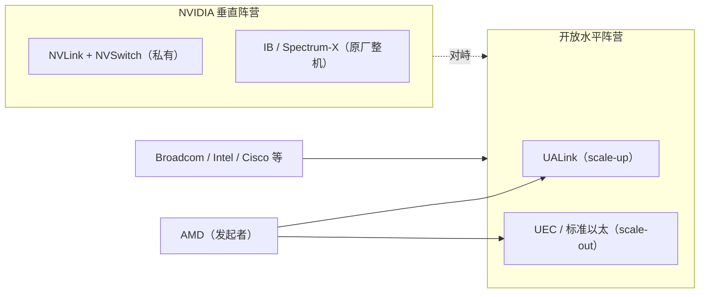

# AMD 网络与 UALink

> 中文简称：AMD 网络与 UALink

> **一句话理解**: AMD 用 Infinity Fabric 管节点内互连、拉着全行业做开放的 UALink 标准管节点间扩展、再买来 Pensando 补上智能网卡，是 NVIDIA 全栈路线最有组织的挑战者。

---

## 一、三件套：Infinity Fabric、UALink、Pensando

- **Infinity Fabric**：AMD 自家互连体系。MI 系列 GPU 在节点内通过 XGMI 链路全互联，同代产品（如 MI300X）节点内聚合带宽约 900GB/s 级（双向口径），量级与 NVLink4 相当；但它只在 AMD 体系内通用，不是开放标准。
- **UALink**：AMD 主导推动的开放 scale-up 互连标准（技术底座源自 AMD 捐赠的 Infinity Protocol），对标 NVLink/NVSwitch，目标是让任何厂家的加速器都能进同一个超节点域。
- **Pensando**：2022 年以约 19 亿美元收购的 DPU 公司，P4 可编程智能网卡，线速提供服务（防火墙、NAT、负载均衡、遥测卸载），公开客户含大型投行与云厂商。

三件套合起来恰好对应 NVIDIA 的 NVLink、IB/Spectrum 与 BlueField。单看每一件都不如 NVIDIA 完整，但每一件都接入了开放生态——这是 AMD 与 NVIDIA 竞争的根本姿态差异。

对采购方的解读方式：买 AMD 不是买"性能更好的网络"，而是买"不被单一厂家定义的网络"——代价是集成与调优责任更多落在自己团队。

---

## 二、UALink 联盟：2024 组建、2025 年 4 月发布 1.0

- 2024 年由 AMD、AWS、Astera Labs、Cisco、Google、HPE、Meta、Microsoft 等发起 Ultra Accelerator Link Promoter Group，随后正式成立 UALink 联盟；Broadcom、Intel 等陆续加入。
- 2025 年 4 月发布 UALink 1.0 规范：每 lane 约 200G、单个域支持 64–1024 个加速器、采用 Load-Store 内存语义，并与 PCIe 软件生态保持迁移兼容性。
- 对标关系：NVLink5 是 1.8TB/s（每 GPU 双向口径）的私有互连；UALink 用开放规范逼近同类能力，靠多家芯片厂与交换厂分工实现，性能靠集体工程而非一家投入。

**表：UALink 1.0 关键口径**

| 项目 | UALink 1.0 口径 | 备注 |
| --- | --- | --- |
| **lane 速率** | 约 200G/lane | 对标 NVLink 同代 lane 能力 |
| **域规模** | 64–1024 个加速器 | 面向机架级/超节点 scale-up |
| **语义** | Load-Store（内存语义） | 与 NVLink 同类，区别于以太消息语义 |
| **生态** | 联盟开放规范 | 多家芯片/交换厂可实现 |

注：1.0 之后联盟规划更高带宽档位，具体规格以联盟正式公告为准，选型评估以可交付硬件为准绳。

---

## 三、Helios 机架：UALink over Ethernet 的工程化

- AMD 于 2025 年宣布、计划 2026 年交付的 Helios 开放机架平台：搭载 MI450 世代 GPU、每架数十卡量级、机架内用 UALink 做 scale-up 互连。
- 关键工程选择是 UALink over Ethernet：用以太物理层与 SerDes 承载 UALink 协议，复用以太产业链（线缆、PHY、交换芯片生态）来降低成本与落地难度。
- 与 NVIDIA NVL 机架对照：NVIDIA 用专用 NVSwitch 托盘 + 铜背板实现机架内全互联；AMD 阵营用开放规范 + 现有以太硬件基础做 scale-up，是"开放但要够快"的折中路线。
- 开放机架规范（OCP 类）协同：Helios 强调遵循开放机架标准，避免整机层面的锁定，与 NVL 的垂直整合形成对照。

这条路线的代价是时序：标准发布（2025-04）到整机量产（2026）之间存在窗口期，NVIDIA 的 NVLink 机架已迭代多代。开放阵营追赶的是"代际差"，不是"有没有"。

---

## 四、开放阵营站位与对峙格局



图：AI 网络的两个阵营——NVIDIA 用私有全栈换取协同性能，开放阵营用标准分工换取多源供应。AMD 是唯一在两个开放标准（UALink、UEC）里都居发起/核心位置的加速器厂商。

- scale-up 层：UALink（AMD、Broadcom 提供芯片路线）vs NVLink/NVSwitch（含 NVLink Fusion 半开放授权）。
- scale-out 层：UEC/标准以太 vs IB 与 Spectrum-X。
- AMD 的站位是开放阵营的组织者，而非单纯参与者——标准的时间表、规范走向与其产品节奏（MI 世代、Helios 机架）深度绑定。

---

## 五、AMD vs NVIDIA 网络能力对比

**表：AMD vs NVIDIA 网络能力（2026 口径，定性比较）**

| 维度 | NVIDIA | AMD |
| --- | --- | --- |
| **节点内互连** | NVLink5 1.8TB/s（双向）+ NVSwitch | Infinity Fabric/XGMI，同代约 900GB/s 级（双向口径） |
| **scale-out** | 自家 IB / Spectrum-X 全家桶 | 标准 RoCE 以太 + 第三方交换机 |
| **在网计算** | SHARP（交换机内聚合） | 无对应量产方案 |
| **DPU/智能网卡** | BlueField-3/4 | Pensando（P4 可编程） |
| **集合通信库** | NCCL | RCCL（沿用 NCCL 接口习惯） |
| **生态** | 封闭但成熟，事实标准 | 开放但仍在建设期 |

注：表中带宽均为厂商公开口径，横向比较需注意统计方式差异（双向聚合 vs 单向线速）。

---

## 六、MI 系列多机训练与推理组网现状

- **节点内**：MI300X/MI325X/MI350 系列八路全互联，显存容量是推理场景的卖点；跨节点没有私有大带宽域，靠标准以太承接。
- **跨节点**：标准 RoCE 以太 + 通用网卡（如 ConnectX 系列）+ RCCL，走开放组网路线，不依赖专网交换机——成本结构简单，但尾延迟控制要靠自己调无损以太。
- **现状**：大规模多机训练的公开标杆案例少于 NVIDIA；推理侧（大显存跑 MoE、长上下文）采用率更高。Helios 与 UALink 落地（2026 年窗口）是其跨节点能力的关键补课。

组网采购清单也比 NVIDIA 简单：交换机在 Broadcom/Cisco/白盒之间多源比价，网卡用通用 RoCE 网卡，线缆光模块走标准以太生态——代价是无损以太的调优责任全部落在使用方。

```bash
# MI 系列多机组网的典型入口（RCCL over RoCE，示意）
export NCCL_SOCKET_IFNAME=eth0         # RCCL 沿用 NCCL 的环境变量习惯
export NCCL_IB_HCA=mlx5_0:1,mlx5_1:1   # 同样可绑定 ConnectX 网卡
export NCCL_DEBUG=INFO                 # 首次组网验证必开
```

---

## 交叉引用

- [[12_架构基建/08_网络/07_GPU_高网设计/01_分层体系/05_UALink|UALink]]
- [[12_架构基建/08_网络/07_GPU_高网设计/01_分层体系/04_NVLink_Fusion|NVLink Fusion]]
- [[12_架构基建/08_网络/07_GPU_高网设计/09_厂家/01_NVIDIA_Networking_Stack|NVIDIA 网络全栈]]
- [[12_架构基建/08_网络/07_GPU_高网设计/09_厂家/08_Intel_Ethernet_Gaudi|Intel 以太路线与 Gaudi]]
- [[12_架构基建/08_网络/07_GPU_高网设计/02_物理层硬件/02_NIC_and_DPU|网卡与 DPU]]
- [[01_数学基础/10_AI硬件/07_NVIDIA_AMD_GPU_深入分析|NVIDIA 与 AMD GPU 深入分析]]

---

*Last updated: 2026-10-27*
