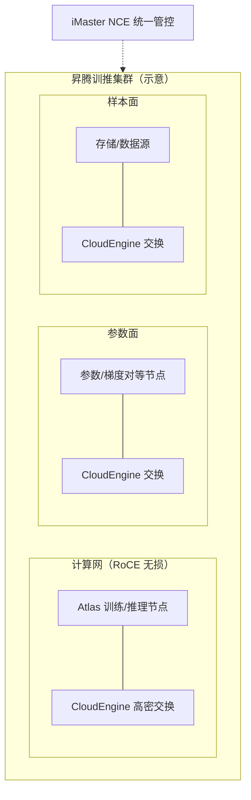

# 华为网络与昇腾组网

> 中文简称：华为网络与昇腾组网

> **一句话理解**: 华为是国内唯一同时自研 AI 芯片（昇腾）和网络设备（CloudEngine）的厂家——用"超节点 + 对等计算架构 + 多平面组网"给出一套不依赖 NVIDIA 的完整答案。

---

## 一、网络侧：CloudEngine 系列与面向 AI 的高密组网

- CloudEngine 系列是华为数据中心交换机主力：CE16800 等高密机型从 400G 起步向 800G 端口世代演进，面向 AI 大模型训练的星河类网络方案主打高密 400G/800G 组网。
- 面向 AI 场景的关键能力是高密低时延转发与大缓存调度：一个 POD 内数百上千张加速卡通过两层 CLOS 组织，跨 POD 再做多层扩展。
- 管控面由 iMaster NCE 承担：意图驱动配置、FabricInsight 类遥测与故障定位，覆盖"配置—监控—排障"闭环。
- 与 NVIDIA 网络的口径差异：华为方案在以太侧（RoCE 无损、运维自动化）积累更深，专网互连（对标 IB 的私有协议栈）体系相对独立。

从 400G 到 800G 的演进不只是端口速率：更高的单口速率意味着更少的光模块与更简单的 CLOS 层数，AI 集群的每卡网络成本随之下降。华为在 800G 世代的产品节奏，是国内新建智算中心组网形态的重要变量。

---

## 二、计算侧：昇腾超节点、HCCS 与 UnifiedBus

- 昇腾（Ascend）910 系列是面向训练/推理的 AI 加速器；Atlas 900/800 系列整机与集群是其载体。
- 节点内互连用 HCCS（Huawei Cache Coherence System）：多颗昇腾芯片在节点内高速全互联，公开带宽口径与同代 NVLink 相比偏低（各方数字口径不一，选型应以实测为准）。
- 跨节点/超节点互连演进到 UnifiedBus 对等总线架构：把数百上千卡组织成一个"超节点域"（SuperPoD 千卡级思路，2025 年起公布的超节点规划即沿此路线），在域内提供比传统以太更高的互连带宽与更低时延。
- 叙事上对标 NVSwitch 机架域：节点内 HCCS + 跨节点 UnifiedBus，共同撑起"超节点"这个国产 scale-up 答案。
- 对外口径上，超节点规模（数百到千卡级）与带宽指标各家统计方式不同，跨厂家比较要先统一口径再看数字。

---

## 三、对等计算架构叙事：参数免集中汇聚

- 传统大规模训练把参数/梯度汇聚到集中式参数服务或全局 AllReduce 树；华为的对等计算架构主张节点间对等互访，内存与参数免集中汇聚。
- 工程含义：KV Cache、参数分片、梯度都可以驻留在对等网络的远端内存中，按需直接读写，减少"先汇聚、再分发"的搬运量。
- 与推理趋势共振：PD 分离与 KV 传输场景（详见 PD 分离与 KV 传输页）天然需要大带宽低时延的内存语义访问，对等总线的价值在推理侧可能比训练侧更直接。
- 需要区分叙事与可验证指标：对等架构的收益依赖应用适配（通信库、框架感知），公开性能口径与第三方实测之间应做交叉验证。

对等架构对网络的要求本质是"把域做大"：域越大，跨域流量越少，对传统 scale-out 的依赖越轻——这正是 UnifiedBus 与超节点叙事绑定出现的原因。

---

## 四、训推一体：计算网 + 参数面 + 样本面多平面



图：华为训推一体组网把计算、参数、样本分平面组织，各自独立扩展与故障域隔离；iMaster NCE 从上层统一下发意图与采集遥测。这是多平面设计思想在国内体系上的完整落地。

- 计算网承载训练梯度同步与推理 KV 传输，要求无损（PFC/ECN 类机制）与低时延。
- 参数面承载参数分发与对等访问，讲求带宽与稳定性。
- 样本面承接数据加载与 checkpoint 读写，吞吐优先。

```bash
# CloudEngine 上面向 AI 集群的常用检查（示意）
display interface | include 400GE     # 高密端口状态与光功率
display buffer configuration          # 无损队列水线配置
display traffic policy interface      # QoS/ECN 策略下发情况
```

---

## 五、与 NVIDIA 生态差异

**表：华为体系 vs NVIDIA 生态（定性比较）**

| 维度 | NVIDIA 生态 | 华为体系 |
| --- | --- | --- |
| **节点内互连** | NVLink5 1.8TB/s（双向）+ NVSwitch | HCCS，公开口径低于同代 NVLink |
| **超节点/机架域** | NVL 机架（铜背板 + NVSwitch 托盘） | SuperPoD 千卡级超节点（UnifiedBus 叙事） |
| **scale-out** | IB / Spectrum-X 私有体系 | CloudEngine + RoCE 标准以太路线 |
| **软件生态** | CUDA/NCCL，全球事实标准 | CANN + 自研通信库，生态建设中 |
| **供应** | 全球多源整机厂 | 国产供应链自主度最高 |
| **合规定位** | 受出口管制约束 | 国内合规与自主创新首选 |

注：本表为体系级定性比较，具体产品代际的逐项规格请以双方产品文档与第三方实测为准。

---

## 六、出口管制背景下的国产替代与选型考量

- 出口管制使国内高端 GPU 供应受限，昇腾 + CloudEngine 成为国内大模型基建的现实主力选项之一；政策与合规侧对国产芯片组网方案有明确倾斜。
- 选型时建议把判断拆成三层：
 1. **生态成熟度**：算子覆盖、框架兼容、社区案例数量，与 CUDA 生态差距需要逐模型验证而非看宣传口径。
 2. **性能口径**：互连带宽、超节点规模等指标各家口径不一，坚持用自己负载的实测（集合通信带宽测试、端到端训练吞吐）说话。
 3. **自主可控权重**：合规要求越高，供应确定性权重越大，性能差距的可接受阈值相应放宽。
- 混合策略常见：训练主力用国产超节点体系，部分推理或研发环境保留兼容生态（用合规途径取得的卡），用多平面网络把两类资源统一纳管。

国产替代不是单选题：多平面架构天然支持分平面选择不同体系——计算网用昇腾超节点、存储与管理网沿用成熟以太生态，是过渡期最平滑的路线。

---

## 交叉引用

- [[12_架构基建/08_网络/02_AI_网络|AI 网络总览]]
- [[12_架构基建/08_网络/07_GPU_高网设计/03_拓扑设计/06_Supernode_MegaPod_MultiPlane|超节点与 MegaPod 多平面]]
- [[12_架构基建/08_网络/07_GPU_高网设计/01_分层体系/03_Multi_Plane_Network_Segmentation|多平面网络分区]]
- [[12_架构基建/08_网络/07_GPU_高网设计/09_厂家/01_NVIDIA_Networking_Stack|NVIDIA 网络全栈]]
- [[12_架构基建/08_网络/07_GPU_高网设计/06_推理网络/03_PD_Disaggregation_KV_Transfer|PD 分离与 KV 传输]]
- [[13_运维/02_SRE与可靠性/10_GPU_集群_Operations_2026|GPU 集群 Operations 2026]]

---

*Last updated: 2026-10-27*
