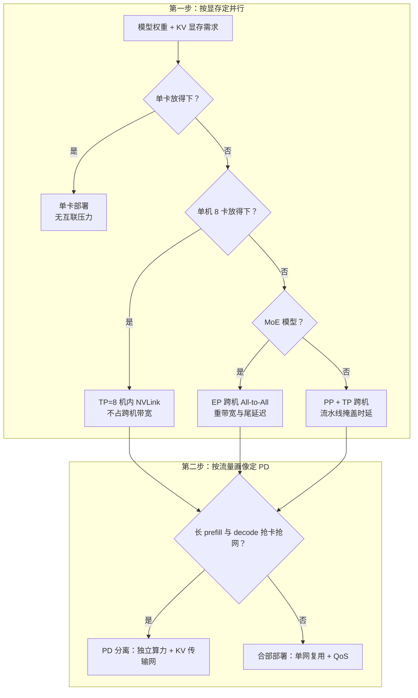

# 推理工程师视角：从 SLO 反推网络

> 中文简称：推理工程师视角

> **一句话理解**: 推理的网络问题最后都体现在 TTFT 和 TPOT 上——会拆指标、会算带宽预算，组网就不会错。

---

## 一、TTFT/TPOT 拆解到网络项

延迟指标必须拆到网络项才能变成组网需求。TTFT（首 token 时延）与 TPOT（每 token 时延）的网络成分完全不同：

| **TTFT 组成项** | **归属** | **网络项** | **敏感度** |
| --- | --- | --- | --- |
| prefill 排队（组批/限流） | 服务层 | 基本无 | 低 |
| prefill 计算 | 计算层 | TP 机内通信、EP 跨机 All-to-All | 高 |
| 权重/KV 加载（冷启动或换模型） | 存储网 | 带宽直接决定加载时长 | 高（冷启动） |
| 首 token 返回 | 业务网 | RTT + 跨机段 | 中 |

| **TPOT 组成项** | **口径** | **说明** |
| --- | --- | --- |
| 每层通信 × 层数 | TP：每层 2 次集合通信；EP：dispatch + combine | 机内微秒级，跨机按 RTT 放大 |
| 每层计算 | batch 摊薄后较稳定 | continuous batching 进一步摊薄 |
| 调度与串行度 | 同卡多请求排队 | 过载时 P99 先于均值恶化 |

算例：80 层模型，TPOT SLO 20ms。若 TP 跨机、每层 2 次集合通信各多 50μs，额外开销 50μs × 2 × 80 ≈ 8ms，直接吃掉 40% 预算——这就是「TP 不跨机」的核心原因，量化分析见 [[12_架构基建/08_网络/07_GPU_高网设计/06_推理网络/02_TP_Cross_Node_Latency|TP 跨机时延]]。

---

## 二、并行策略组网决策树



先按显存定并行，再按流量画像定 PD 是否分离：前者决定计算网的带宽/时延规格，后者决定要不要专门规划 KV 传输路径。

---

## 三、PD 分离的 KV 传输设计要点

带宽预算公式是所有设计的起点：

```text
每 token KV 体量 = 2（K 与 V）× 层数 × KV 头数 × head_dim × dtype 字节数
示例：80 层 × 8 KV 头 × head_dim 128 × FP16(2B) × 2 = 每 token 约 320KB
4K 上下文 → 每请求 KV 约 1.3GB
带宽需求 = 并发数 × 每请求 KV ÷ 时延预算
示例：100 并发 × 1.3GB ÷ 0.1s ≈ 1.3TB/s（聚合口径）
```

按每机 8 张 400G 网卡聚合 3.2Tb/s（约 400GB/s）折算，1.3TB/s 相当于 3–4 台整机的网卡带宽专门服务 KV 交班——这就是 PD 分离必须认真做传输设计的原因。

| **设计点** | **做法** | **坑** |
| --- | --- | --- |
| zero-copy | RDMA 直写显存/注册内存，GPUDirect 路径 | 注册内存生命周期管理 |
| 分块流水 | KV 按 chunk 切片，边算边传 | chunk 太小协议开销大、太大时延抖动 |
| 背压 | decode 侧 ready 队列满则反压 prefill 侧准入 | 不做背压，高峰直接 OOM |
| 多平面 | KV 传输与业务面/参数面隔离 | 共享链路被大流挤压，P99 恶化 |

工程细节展开见 [[12_架构基建/08_网络/07_GPU_高网设计/06_推理网络/03_PD_Disaggregation_KV_Transfer|PD 分离 KV 传输]] 与 [[12_架构基建/08_网络/07_GPU_高网设计/06_推理网络/04_Mooncake_KV_Pool|Mooncake KV 池]]。

---

## 四、KV 命中率：前缀复用直接砍传输量

system prompt、few-shot 示例、多轮对话历史都是可复用前缀。命中即可免传输（甚至免重算 prefill），TTFT 与 KV 传输带宽双降：

| **前缀命中率** | **KV 传输量（定性）** | **TTFT 收益** |
| --- | --- | --- |
| 0%（无复用） | 每请求全量交班 | 基线 |
| 50% | 传输量砍半 | 显著下降 |
| 90%（长系统提示 + 多轮对话） | 只传增量 | 大部分请求接近 decode-only |

工程要点：命中粒度按 token 块对齐；前缀哈希要处理失效与多副本；缓存分层（本机显存 → KV 池 → 远端节点）决定传输路径。命中率每提高一档，第三节的带宽预算就同步缩一档——先优化命中率再扩网络。

---

## 五、抖动敏感：P99 与长尾

decode 每步的通信是小包（微秒级），一旦与 prefill 的大流（GB 级）共享链路就被挤压：均值几乎不变，P99 明显恶化——而 SLO 恰恰按 P99 验收。

| **手段** | **层次** | **效果与代价** |
| --- | --- | --- |
| 物理隔离 | 独立网卡/独立组网 | 最彻底，成本最高 |
| 逻辑隔离 | 专用队列、QoS/ECN 门限 | 折中，需精细调参 |
| 调度隔离 | prefill/decode 分机（PD 分离本身） | 同时解决抢卡与抢网 |

多租户与混部场景的隔离细节见 [[12_架构基建/08_网络/07_GPU_高网设计/07_运维故障/05_Multi_Tenant_Isolation|多租户隔离]]。

---

## 六、从 SLO 反推网络规格：一个算例

| **SLO 指标** | **目标** | **网络预算拆分** |
| --- | --- | --- |
| TTFT P99 | ≤ 1.0s | 网络共 ≤ 150ms（权重加载 ≤ 100ms + 首 token ≤ 50ms） |
| TPOT P99 | ≤ 30ms | 跨机通信 ≤ 3ms（每层 2 次通信共 160 次，每次 ≤ 约 19μs） |
| 并发 | 1000 路 | KV 传输带宽按「并发 × KV ÷ 时延预算」反推 |

推演链：每层通信预算约 19μs → 机内 NVLink（微秒级）轻松满足，跨机 RDMA 精调勉强，跨机 TCP 直接出局 → 结论：TP 只在机内做，跨机只走 EP/PP。KV 交班按第三节约 1.3TB/s 聚合口径规划专属传输面，并对 prefill 突发做限速隔离。

训练侧的同款决策逻辑对照见 [[12_架构基建/08_网络/07_GPU_高网设计/10_视角/01_Training_Angle|训练工程师视角]]；流量画像差异见 [[12_架构基建/08_网络/07_GPU_高网设计/06_推理网络/01_Training_vs_Inference_Traffic|训练 vs 推理流量画像]]。

---

## 交叉引用

- [[12_架构基建/08_网络/07_GPU_高网设计/06_推理网络/01_Training_vs_Inference_Traffic|训练 vs 推理流量画像]]
- [[12_架构基建/08_网络/07_GPU_高网设计/06_推理网络/02_TP_Cross_Node_Latency|TP 跨机时延]]
- [[12_架构基建/08_网络/07_GPU_高网设计/06_推理网络/03_PD_Disaggregation_KV_Transfer|PD 分离 KV 传输]]
- [[12_架构基建/08_网络/07_GPU_高网设计/06_推理网络/04_Mooncake_KV_Pool|Mooncake KV 池]]
- [[12_架构基建/08_网络/07_GPU_高网设计/10_视角/01_Training_Angle|训练工程师视角]]
- [[10_部署推理/03_推理优化/13_Prefill_Decode_Disaggregation|Prefill/Decode 分离]]

---

*Last updated: 2026-10-27*
