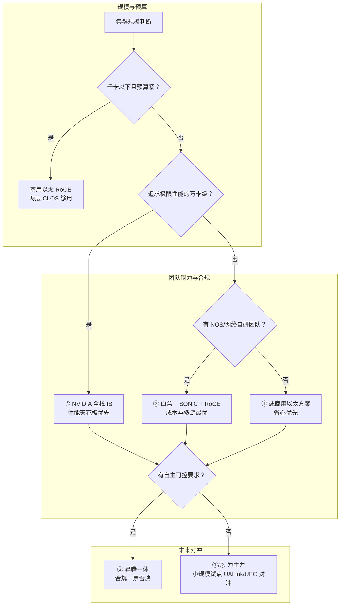

# 选型决策视角：四条路线与 POC 验收

> 中文简称：选型决策视角

> **一句话理解**: 选网络路线本质是在性能、成本、锁定与团队能力之间下注——先排自由度，再谈价格。

---

## 一、四条路线对比总表

| **维度** | **① NVIDIA 全栈** | **② 以太白盒自研** | **③ 华为昇腾一体** | **④ 开放联盟** |
| --- | --- | --- | --- | --- |
| 组成 | NVLink 机内 + IB 跨机 + NCCL | Broadcom/Marvell 交换芯片 + SONiC + RoCE 网卡 | CloudEngine + Atlas + CANN 生态 | UALink scale-up + UEC scale-out |
| 性能 | 天花板最高（NVLink5 1.8TB/s 双向、SHARP） | 精调后接近 | 体系内闭环、对标主流 | 标准先进、性能待验证 |
| 成本 | 最贵 | 硬件最省、人力最贵 | 中等、随生态规模摊薄 | 未知 |
| 人力门槛 | 最低（原厂工具链全） | 最高（NOS 自研能力为准入） | 中（新栈学习成本） | 高（早期参与成本） |
| 供应链 | 单一来源 | 多源可选 | 自主可控 | 多源但未规模量产 |
| 成熟度 | 量产多年 | 头部云厂验证过 | 国内规模部署 | 标准与首发产品阶段 |

每条路线一句点评：

- ①用溢价买确定性与性能上限，锁定也最深，详见 [[12_架构基建/08_网络/07_GPU_高网设计/09_厂家/01_NVIDIA_Networking_Stack|NVIDIA 网络全栈]]
- ②成本与多源的最优解，前提是养得起团队，详见 [[12_架构基建/08_网络/07_GPU_高网设计/09_厂家/02_Broadcom_Switching|Broadcom 交换]]
- ③合规驱动的体系化选择，生态自成一体，详见 [[12_架构基建/08_网络/07_GPU_高网设计/09_厂家/07_Huawei_CloudEngine_Atlas|华为 CloudEngine/Atlas]]
- ④面向下一个世代的开放标准，当前只适合小规模试点，详见 [[12_架构基建/08_网络/07_GPU_高网设计/01_分层体系/05_UALink|UALink]] 与 [[12_架构基建/08_网络/07_GPU_高网设计/04_协议传输/05_IB_vs_Ethernet_SpectrumX_UEC|IB vs 以太 SpectrumX UEC]]

---

## 二、选型决策树



决策顺序：规模与预算先收窄选项，团队能力与合规再做取舍，最后用小规模试点对冲技术代际风险——主流量产路线与未来标准不必二选一。注意合规是一票否决项，应放在决策树靠前的位置评估。

---

## 三、锁定风险与退出成本评估表

| **维度** | **锁定表现** | **退出成本** | **缓解手段** |
| --- | --- | --- | --- |
| 技能 | 团队只会 NCCL/UFM 那一套工具链 | 重新培训周期长、故障处理能力断层 | 保持第二栈小规模试点与轮岗 |
| 库存 | 备件与模块为专用形态 | 换代残值低、库存减值 | 按周转率备件，避免超储押注 |
| 软件耦合 | 并行配置、调度脚本深度绑定拓扑与驱动 | 迁移要重写运维剧本与作业模板 | 用抽象层（调度器 device plugin 等）隔离差异 |
| 生态 | 认证体系、监控栈、合同条款围绕单一厂家 | 招聘与供应商切换周期长 | 每年一次 lock-in review，量化退出成本写进决策记录 |

锁定最深的是①（软硬件与生态三层全绑）；②的锁定在自家人才上（人走栈凉）；③的锁定在生态切换成本；④当前的问题恰好相反——是成熟度不足而非锁定过度。

---

## 四、POC 验收清单

```bash
# 带宽基线：全组 nccl-tests 回归（256MB allreduce、PPN=8）
mpirun -np <NP> --hostfile hosts -x NCCL_DEBUG=INFO \
  ./build/all_reduce_perf -b 8M -e 1G -f 2 -w 20
# 达标线：400G 口径 busbw ≥ 45GB/s、800G 口径 ≥ 90GB/s（约线速 90%）
```

| **验收项** | **方法** | **通过标准** |
| --- | --- | --- |
| 带宽基线 | nccl-tests 全消息段扫描 | 达标线 ±5% 以内，且各节点离散度小 |
| 故障注入 | 拔线、重启 spine、注入单链路降速 | 无静默降级；恢复时间符合预案 |
| 混合负载长稳 | 7 天训练 + 推理混合流量 | busbw 跌幅 < 5%，零 P0/P1 事件 |
| 回退方案 | 实际演练一次完整回滚 | 回到变更前基线，数据与作业无损 |
| 供应链交期 | 按扩容计划核实器件交期承诺 | 峰值交期满足下一期扩容窗口 |

读数方法详见 [[12_架构基建/08_网络/07_GPU_高网设计/05_集合通信/06_NCCL_Tests_Reading|nccl-tests 结果解读]]。POC 最容易翻车的是第三项：短跑全绿、长稳掉档，多数是流控参数与散热问题暴露；第五项则最常被忽略——选型时买得到，扩容时买不到。

---

## 五、谈判要点

| **要点** | **内容** | **为什么重要** |
| --- | --- | --- |
| 多源 | 光模块/线缆至少两家供应商 | 光模块是第一大故障源与成本项 |
| 备件 SLA | 到场时限、换新周转写进合同 | 故障恢复速度直接等于 GPU 利用率 |
| 固件齐平义务 | 同批次固件版本一致、升级窗口受支持 | 混版本是 RoCE 类诡异问题的第一大来源 |
| 按 TCO 谈 | 按整网五年总成本而非单台报价 | license、人力、电费这些隐藏项才决定胜负 |
| 退出条款 | 价格保护期、末次采购权（EOL 补货）写进合同 | 降低第三节评估的库存锁定风险 |

谈判姿态：两条以上路线保持实质接触到最后一轮，报价才有梯度；单源谈判省下的时间，最终都会以溢价形式还回去。成本侧的完整测算口径见 [[12_架构基建/08_网络/07_GPU_高网设计/10_视角/04_Cost_Angle|成本视角]]。

---

## 交叉引用

- [[12_架构基建/08_网络/07_GPU_高网设计/09_厂家/01_NVIDIA_Networking_Stack|NVIDIA 网络全栈]]
- [[12_架构基建/08_网络/07_GPU_高网设计/09_厂家/02_Broadcom_Switching|Broadcom 交换]]
- [[12_架构基建/08_网络/07_GPU_高网设计/09_厂家/07_Huawei_CloudEngine_Atlas|华为 CloudEngine/Atlas]]
- [[12_架构基建/08_网络/07_GPU_高网设计/01_分层体系/05_UALink|UALink]]
- [[12_架构基建/08_网络/07_GPU_高网设计/04_协议传输/05_IB_vs_Ethernet_SpectrumX_UEC|IB vs 以太 SpectrumX UEC]]
- [[12_架构基建/08_网络/07_GPU_高网设计/10_视角/04_Cost_Angle|成本视角]]

---

*Last updated: 2026-10-27*
