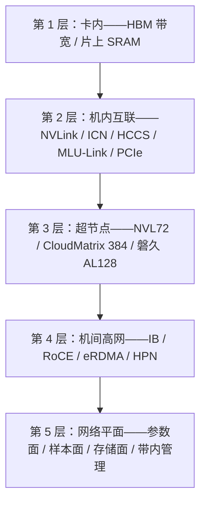

# 高网知识地图 2026

> 中文简称：高网知识地图

> **一句话理解**: 把「数据在算力集群里怎么流动」切成五层楼——卡内、机内、超节点、机间、网络平面，每层楼有自己的技术和厂家，任何高网问题都能先定位到楼层再谈方案。

---

## 1. 五层通信金字塔

**图意**：自下而上带宽递减、时延递增；一次训练任务的通信会同时跨多层，排障时必须先说清楚「哪一层慢」，否则所有数字都不可比。

| 层级 | 典型带宽量级 | 代表技术 | 详见 |
|---|---|---|---|
| 卡内 | 3–8 TB/s | HBM3e、片上 SRAM | [[概念/GPU/gpu-interconnect|GPU 互联技术]] |
| 机内互联 | 400 GB/s–1.8 TB/s | NVLink 5、ICN、HCCS、MLU-Link | 厂家篇 07–19 |
| 超节点 | 聚合数十 TB/s | NVL72、CloudMatrix、ESL | [[12_架构基建/08_网络/PPU与高网/02_超节点技术_2026|02 超节点技术]] |
| 机间高网 | 单端口 100–800 Gb/s | IB、RoCE v2、eRDMA、HPN | [[12_架构基建/08_网络/06_RDMA_and_RoCE_for_AI|RDMA 与 RoCE]] |
| 网络平面 | 组网设计问题 | 参数面/样本面/存储面分离 | 本文第 4 节 |

---

## 2. 关键指标：先对口径，再比数字

| 指标 | 口径要点 | 常见坑 |
|---|---|---|
| **互联带宽** | 单向还是双向、聚合还是单端口 | 真武 810E 的 700 GB/s 是片间互联口径，ICN Switch 25.6 Tbps 是交换芯片口径，不可相加（见 [[01_数学基础/10_AI硬件/09_PPU_High_Performance_Network|PPU 高性能网络与 ICN 互联]]） |
| **集合通信带宽** | busbw 与 algbw 是两个数 | 详见 [[12_架构基建/08_网络/PPU与高网/05_高网性能测量方法_2026|05 测量方法]] |
| **时延** | 单跳、跨机、端到端要分开 | 超节点百纳秒级、机间微秒级，差一个数量级 |
| **等分带宽（bisection）** | 集群对半分的总带宽 | 拓扑收敛比的决定项，厂商常回避公布 |
| **网络利用率** | 峰值 vs 训练稳态 | HPN 论文口径：大模型训练是周期性突发大流，不能按均值规划 |

---

## 3. 软件栈映射：每层楼配一套软件

| 层级 | 软件/库 | 说明 |
|---|---|---|
| 通信库 | NCCL、HCCL、ACCL-P、XCCL、RCCL、MCCL、oneCCL | 各厂家一间房，横向对比见 [[12_架构基建/08_网络/PPU与高网/06_集合通信库全景_2026|06 通信库全景]] |
| RDMA 动词层 | ibverbs、efadv（eRDMA 扩展） | 用户态直接投递内存读写 |
| 拓扑发现 | nvidia-smi topo、ppu-smi、hccn_tool | 设备顺序≠最优通信顺序，PPU 官方按 TP 度给出不同顺序 |
| 框架后端 | torch.distributed、DeepSpeed、Megatron | 选择通信库与并行策略的绑定关系 |
| 拥塞控制 | DCQCN、HPCC、自研 CC（eRDMA） | RoCE 系可调，IB 相对封闭 |

---

## 4. 网络平面：一张高网不是一张网

AI 集群通常按流量性格拆成多张物理/逻辑网络，混跑会互相打死：

| 平面 | 流量特征 | 典型组网 |
|---|---|---|
| **参数面（计算网）** | AllReduce/All-to-All，周期性大流 | IB/RoCE 专用面，HPN 双平面（见 [[01_数学基础/10_AI硬件/09_PPU_High_Performance_Network|PPU 高性能网络与 ICN 互联]] §5） |
| **样本面** | 数据加载，持续中流 | 25/100 GbE，可与服务面合设 |
| **存储面** | checkpoint 读写，突发巨流 | RoCE 或高速以太，与参数面分离 |
| **带内管理** | 监控、IPMI/BMC | 低速网，绝不过高网 |

> PD 分离推理架构下，Prefill→Decode 的 KV 传输是新增的「第四种流量」，对网络的要求介于参数面与存储面之间，详见 [[21_面试岗位/19_LLM平台工程师/06_PD分离_面试复习|PD 分离面试复习]]。

---

## 5. 知识点自检清单

- [ ] 能说出五层金字塔每层的代表技术与量级；
- [ ] 能解释「互联带宽」的三种口径（单向/双向/聚合）与不可相加原则；
- [ ] 能区分 scale-up（机内/超节点）与 scale-out（机间）通信域；
- [ ] 能列出参数/样本/存储/管理四平面各自的流量性格；
- [ ] 知道每层对应的排障工具入口（见 [[12_架构基建/08_网络/05_网络_Diagnostics_命令|网络 Diagnostics 命令]]）。

---

## Related

- [[12_架构基建/08_网络/PPU与高网/README|PPU 与高网系列总纲]]
- [[12_架构基建/08_网络/01_AI_网络_基础|AI 网络基础]]
- [[12_架构基建/08_网络/02_AI_网络|AI 网络基础设施]]

---

*Last updated: 2026-10-27*
