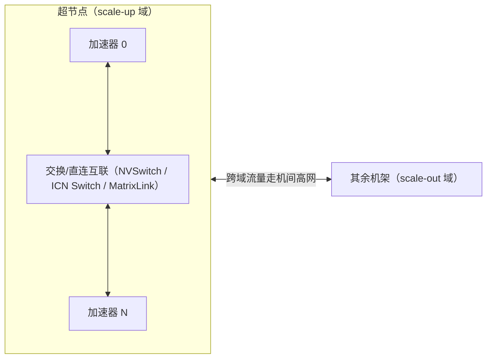

# 超节点技术 2026

> 中文简称：超节点

> **一句话理解**: 超节点 = 把一整排服务器的卡用「总线级」互联焊成一个大脑，让 72 卡、384 卡像同一台机器里的 8 张卡一样通信——MoE 的 All-to-All 和 PD 分离的 KV 搬运最吃这一口。

---

## 1. 为什么 2026 年超节点爆发

| 驱动力 | 对网络的要求 | 超节点的回答 |
|---|---|---|
| MoE 大模型（DeepSeek 类） | 专家并行的 All-to-All 流量巨大且时延敏感 | 把 EP 域收进超节点内，走总线不走网卡 |
| 长上下文推理 / PD 分离 | Prefill→Decode 的 KV 传输动辄数十 GB | 超节点内 KV 搬运带宽比跨机高一个量级 |
| 大规模 DP 训练 | AllReduce 总量随卡数线性涨 | 超节点内先归约再上机间网，减少跨机流量 |
| 通信语义 | 消息传递（send/recv）开销高 | 类内存语义（load/store）降低软件栈开销 |

---

## 2. 横向对比：五家超节点

| 超节点 | 厂家 | 规模口径 | 互联技术 | 关键数字（官方口径） |
|---|---|---|---|---|
| **GB200 NVL72** | NVIDIA | 72 GPU 机架 | NVLink 5 + NVSwitch | NVLink 域内 130 TB/s 聚合带宽（详见 [[12_架构基建/08_网络/PPU与高网/07_NVIDIA_互联与组网|NVIDIA 互联与组网]]） |
| **CloudMatrix 384** | 华为 | 384 NPU + 192 鲲鹏 CPU | MatrixLink 全对等互联 | 算力规模 300 PFLOPs，芜湖规模部署（详见 [[12_架构基建/08_网络/PPU与高网/08_华为昇腾互联与组网|华为昇腾互联与组网]]） |
| **磐久 AL128** | 阿里/平头哥 | 128 卡（64 卡全带宽 + 128 卡超节点两档口径） | ICN + ICN Switch 1.0 | 交换吞吐 25.6 Tbps；通信时延低至百纳秒级（详见 [[01_数学基础/10_AI硬件/09_PPU_High_Performance_Network|PPU 高性能网络与 ICN 互联]]） |
| **昆仑芯超节点** | 昆仑芯 | 单柜 32/64 卡 | XPU-Link 柜内全互联 | 柜内带宽提升高达 8 倍（详见 [[12_架构基建/08_网络/PPU与高网/11_昆仑芯互联与组网|昆仑芯互联与组网]]） |
| **云燧 ESL** | 燧原 | 单节点最高 64 卡全带宽 | GCU-LARE | 单节点聚合带宽 51.2 TB/s、存储带宽 230 TB/s（详见 [[12_架构基建/08_网络/PPU与高网/12_燧原互联与组网|燧原互联与组网]]） |

> **口径纪律**：每家的「规模」定义不同——NVL72 是 72 卡全互联；CloudMatrix 是 384 卡全对等；磐久 AL128 的「128 卡超节点」≠「128 卡全带宽」（官方明确全带宽口径是 64 卡）。对比时先统一口径。

---

## 3. 超节点内部的组网逻辑

**图意**：超节点是「放大版的机内互联 + 缩小版的集群网络」的混合体。跨过超节点边界的流量性质骤变（总线→RDMA 网络），所以**调度器必须知道超节点边界**——把通信密集的并行域（TP/EP）压在边界内，把 DP/PP 放到边界外。

---

## 4. 工程影响

| 关注点 | 实践 |
|---|---|
| **并行策略放置** | TP/EP 优先超节点内；PP 相邻阶段同域；DP 可跨域 |
| **框架感知** | Megatron/DeepSpeed/vLLM 需要拓扑感知的 device mesh，不能按逻辑卡号排 |
| **故障域** | 超节点越大，单点故障影响越大——NVL72/384 卡整域检修是真实运维成本 |
| **功耗与散热** | 百卡级超节点普遍液冷，机房改造是前置条件 |
| **成本曲线** | 超节点内带宽贵、机间便宜，最优并行度=在两种带宽价格间找平衡 |

---

## 5. 开放问题

1. **标准化之争**：NVLink Fusion 开放、UALink 1.0（200G/lane、单 Pod 1024 加速器）挑战，国产各家自研——短期互不兼容。
2. **超节点规模上限**：64→128→384 的扩展中，全带宽口径如何保持，公开资料普遍没有讲清楚收敛比。
3. **与以太网的边界战争**：超以太网联盟（UEC）想让「高级以太网」吃掉一部分 scale-up 场景，2026 年尚未收敛。

---

## Related

- [[12_架构基建/08_网络/PPU与高网/README|PPU 与高网系列总纲]]
- [[01_数学基础/10_AI硬件/09_PPU_High_Performance_Network|PPU 高性能网络与 ICN 互联]]
- [[概念/GPU/gpu-interconnect|GPU 互联技术]]

---

*Last updated: 2026-10-27*
