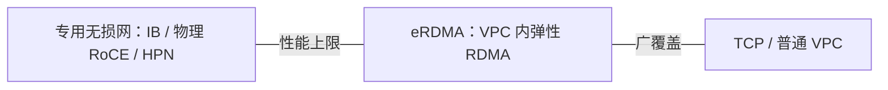

# eRDMA 深入分析

> 中文简称：eRDMA 弹性 RDMA

> **一句话理解**: 传统 RDMA 要求专门搭一张物理网络，eRDMA 让你在阿里云普通 VPC 里「开个开关」就获得 RDMA 能力——本质是把 RDMA 的活儿下沉到神龙 CIPU 芯片里做，代价与收益都来自这一点。

---

## 1. eRDMA 是什么

| 维度 | 内容 |
|---|---|
| 定义 | Elastic RDMA：基于 VPC 网络实现的 RDMA 直通，绕过内核协议栈直接读写对端内存 |
| 发布 | 2021 云栖大会，随第四代神龙架构（CIPU 路线）推出，官方称业界首个大规模云上弹性 RDMA |
| 载体 | 弹性 RDMA 网卡 **ERI**：依附于弹性网卡（ENI）开启 RDMA 功能，作为虚拟资源随实例弹性分配 |
| 兼容 | 用户态 verbs 接口兼容标准 RDMA 生态（ibverbs），并有 efadv 扩展接口 |
| 计费 | 功能本身不额外收费，按底层 ECS/网络资源计费（以官方定价页为准） |

---

## 2. 技术要点

### 2.1 与经典 RDMA 网络的差异

| 维度 | 专用 RDMA 网（IB/物理 RoCE） | eRDMA |
|---|---|---|
| 网络 | 专用无损局域网（PFC/ECN 精调） | 复用 VPC 有损网络 |
| 拥塞控制 | DCQCN/HPCC，运维调优重 | 自研 CC 算法，容忍 VPC 内延迟与丢包 |
| 部署 | 物理规划、固定拓扑 | 控制台/接口开通，随实例伸缩 |
| 性能上限 | 高（专用无损网） | 低于专用网，但显著优于 TCP |

### 2.2 自研拥塞控制是关键

云上 VPC 是有损网络，标准 RoCE 在丢包下性能坍塌。eRDMA 的核心工程点是在 **CIPU 卸载路径上实现可容忍丢包的拥塞控制**，在有损环境里保住 RDMA 的低时延与大吞吐——这也是它区别于「ECS 里插一块 RoCE 网卡」的根本所在。

### 2.3 与 HPN 的关系

- **eRDMA**：面向通用 ECS/ACK 场景的「普惠」RDMA，弹性优先；
- **HPN（高性能网络）**：面向大规模训练集群（如灵骏）的专用高网架构——多轨双平面、专用 RDMA 网卡（PPU 实例使用自研 RDMA 网卡即属此类体系），见 [[01_数学基础/10_AI硬件/09_PPU_High_Performance_Network|PPU 高性能网络与 ICN 互联]] §5。
- 两者不是替代关系：前者做广覆盖，后者做大集群极限性能。

---

## 3. 典型使用场景

| 场景 | 用法 | 参考 |
|---|---|---|
| ACK 上 GPU 多机训练 | 支持 eRDMA 的 GPU 实例 + arena 提交训练任务，NCCL 走 eRDMA 通道 | 阿里云 ACK 文档 |
| 多机推理 / PD 分离 | Prefill-Decode 间 KV 传输走 RDMA 降低时延 | [[21_面试岗位/19_LLM平台工程师/06_PD分离_面试复习|PD 分离面试复习]] |
| HPC/大数据 Shuffle | 替代 TCP 降低集群内通信开销 | ECS 最佳实践 |

---

## 4. 使用边界与坑

1. **实例与镜像匹配**：需要实例规格支持 eRDMA、镜像内置驱动；容器场景要配置设备挂载。
2. **性能预期管理**：官方口径「延迟较 VPC（TCP）降低约 80%」，但与专用无损网（IB/HPN）相比仍有差距；压测时先固定基线（方法见 [[12_架构基建/08_网络/PPU与高网/05_高网性能测量方法_2026|05 测量方法]]）。
3. **NCCL 通道选择**：确认 NCCL 实际选用了 RDMA 传输（`NCCL_DEBUG=INFO` 看 transport），而不是静默回退到 Socket。
4. **网络安全组**：RDMA 流量同样受安全组规则约束，放通规则要与训练端口一致。

---

## 5. 在高网版图中的位置

**图意**：eRDMA 位于「专用高网」与「普通以太」之间——用 CIPU 卸载换取 RDMA 语义，用弹性换掉一部分极限性能，是把 RDMA 从「专属集群特权」变成「普通云资源」的中间档。

---

## Related

- [[12_架构基建/08_网络/PPU与高网/README|PPU 与高网系列总纲]]
- [[12_架构基建/08_网络/06_RDMA_and_RoCE_for_AI|RDMA 与 RoCE 在 AI 集群中的应用]]
- [[12_架构基建/06_云厂商/Alibaba_Cloud/产品/10_算力与基础设施|阿里云算力与基础设施]]

---

*Last updated: 2026-10-27*
