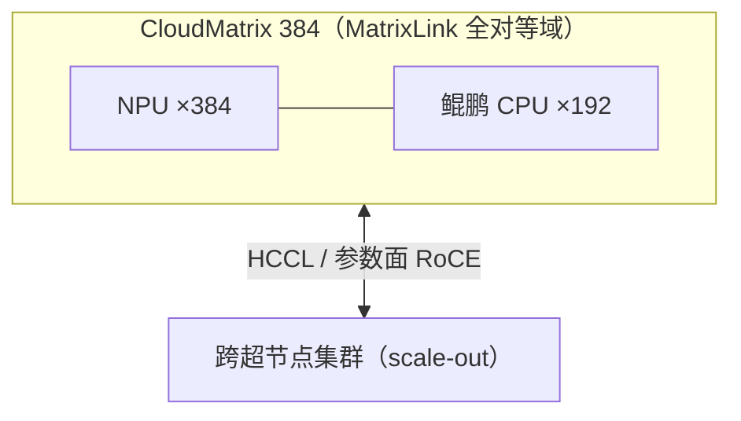

# 华为昇腾互联与组网

> 中文简称：华为昇腾互联

> **一句话理解**: 昇腾用「机内 HCCS + 超节点 MatrixLink + 参数面 RoCE」三件套对抗 NVIDIA——CloudMatrix 384 用 384 颗 NPU 的全对等互联，走「规模换单卡性能」的路线。

---

## 1. 互联技术分层

| 层级 | 技术 | 说明 |
|---|---|---|
| 机内卡间 | **HCCS**（Huawei Cache Coherent System） | 昇腾卡间高速互联，公开口径约 392 GB/s 量级（910 系列，以官方为准），对标 NVLink 3.0 代际 |
| 超节点 | **MatrixLink** | CloudMatrix 384 中连接 384 NPU + 192 鲲鹏 CPU 的全对等高速互联 |
| 机间参数面 | RoCE（以太路线） | 华为参数面走以太 RoCE 而非 IB；配套 CE 系列交换机 |
| 通信库 | **HCCL** | CANN 软件栈内的集合通信库（NCCL 等价物），见 [[12_架构基建/08_网络/PPU与高网/06_集合通信库全景_2026|06 通信库全景]] |

---

## 2. CloudMatrix 384：超节点旗舰

2025 年 4 月发布、已通过昇腾云商用（芜湖规模部署）：

| 维度 | 官方口径 |
|---|---|
| 组成 | 384 颗昇腾 NPU + 192 颗鲲鹏 CPU，全对等（full-peer）互联，组成一台「超级 AI 服务器」 |
| 算力 | 300 PFLOPs（官方发布口径） |
| 定位 | 高密、高速、高效——算力/互联带宽/内存带宽「全面领先」的宣传口径 |
| 实战 | DeepSeek-R1 训练迭代速度对标 H100 集群表现强劲（华为口径） |

**与 GB200 NVL72 的对比口径**（超节点横向对比见 [[12_架构基建/08_网络/PPU与高网/02_超节点技术_2026|02 超节点技术]]）：

| 维度 | NVL72 | CloudMatrix 384 |
|---|---|---|
| 单域规模 | 72 GPU | 384 NPU（约 5 倍规模） |
| 路线 | 单卡性能极致（Blackwell） | 规模堆叠补单卡代差（910 系列多 die/多卡） |
| 功耗 | 液冷机架 | 液冷机架，功耗口径更高（按单位算力各有算法） |

> 业界普遍以「每 PFLOPS 的功耗/带宽」重算对比，结论分歧较大——引用时标注口径来源，避免直接搬营销数字。

---

## 3. 组网与软件栈

**图意**：跨过 MatrixLink 域即进入常规 RoCE 参数面——超节点内是总线语义，超节点外是网络语义，调度边界依然是工程关键。

- **软件栈**：CANN（对标 CUDA 全栈）+ HCCL + MindSpore/MindIE（推理引擎）；
- **生态位**：信创/政企市场先发优势最大，万卡级集群部署案例多；
- **推理侧**：昇腾推理指南见 [[10_部署推理/05_硬件与算力/02_Ascend_NPU_推理_指南|Ascend NPU 推理指南]]，概念页 [[概念/General/mindie|MindIE]]。

---

## 4. 已知与未知（沿用 09 页的口径纪律）

**有官方依据**：CloudMatrix 384 的 384 NPU+192 CPU 组成与全对等互联；300 PFLOPs 与芜湖商用部署；华为参数面以太 RoCE 路线。

**公开资料不足**：MatrixLink 单链路带宽与时延规格；384 卡全对等的实际收敛比；HCCS 各代详细演进表（392 GB/s 为社区口径，非官方数据手册）。

---

## 5. 面试速记

1. HCCS 管机内、MatrixLink 管超节点、RoCE 管机间——三层不要混；
2. CloudMatrix 384 的差异化叙事是「系统带宽密度」，不是单卡跑分；
3. HCCL 与 NCCL 的关系：接口习惯相近、拓扑感知对象不同（HCCS/RoCE vs NVLink/IB）。

---

## Related

- [[12_架构基建/08_网络/PPU与高网/README|PPU 与高网系列总纲]]
- [[12_架构基建/08_网络/PPU与高网/02_超节点技术_2026|02 超节点技术]]
- [[01_数学基础/10_AI硬件/03_Chinese_AI_Chips_深入分析|国产 AI 芯片深度解析]]

---

*Last updated: 2026-10-27*
