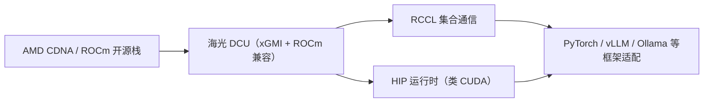

# 海光 DCU 互联与组网

> 中文简称：海光 DCU 互联

> **一句话理解**: 海光 DCU 是国产卡里最「像 AMD」的一支——架构脱胎于 AMD CDNA 授权，互联用 xGMI、软件栈用 ROCm/RCCL，生态复用是它最大的差异化。

---

## 1. 产品与互联事实

| 维度 | 内容（公开口径） |
|---|---|
| 产品线 | DCU（Deep Computing Unit）深算系列；主力推理/训推卡 **K100-AI** |
| 架构来源 | GPGPU 架构脱胎于 AMD CDNA，宣称已形成自主可控版本 |
| 显存 | K100-AI 64 GB HBM2e、4096-bit 总线（对标大模型推理的容量/带宽需求） |
| 算力 | K100 INT8 峰值 256 TOPS（社区/渠道口径） |
| 机内互联 | **xGMI**（AMD Infinity Fabric 同源协议）多卡互联，可组建千卡级集群 |
| 机间 | 以太/RoCE 组网，公开参考架构少 |

> xGMI 是 AMD Infinity Fabric 的 GPU 间接口（AMD 侧现状见 [[12_架构基建/08_网络/PPU与高网/16_AMD_互联与组网|AMD 互联与组网]]）；海光具体链路速率官方未公开逐项，引用时避免杜撰数字。

---

## 2. 生态复用：海光路线的核心优势

**图意**：海光几乎整套复用 AMD 的开源软件路线——通信库（RCCL）、运行时（HIP）、框架适配全链路，CUDA 应用大部分可低改造成本迁移。这在国产卡里迁移成本最低，代价是架构自主性叙事弱于全自研厂家。

- 实战案例：8×K100-AI 跑 DeepSeek 满血版推理（社区实测）、Ollama/vLLM 适配指南均已公开；
- 通信库定位见 [[12_架构基建/08_网络/PPU与高网/06_集合通信库全景_2026|06 通信库全景]]（RCCL 行）。

---

## 3. 组网注意点

1. **拓扑工具**：沿用 ROCm 系工具（rocm-smi、rccl 调试变量），排障习惯与 AMD 集群一致；
2. **xGMI 域**：xGMI 是机内/近邻互联，跨域即走 RoCE——设备放置逻辑与 NVLink 域同理（TP 压域内）；
3. **版本对齐**：ROCm 版本与 DCU 驱动的匹配矩阵是高频坑，社区文档分散，升级前先查厂商兼容表。

---

## 4. 已知与未知

**有公开依据**：K100-AI 64 GB HBM2e/4096-bit；CDNA 出身与 ROCm 生态复用；xGMI 互联与千卡级集群口径；DeepSeek/vLLM/Ollama 适配案例。

**公开资料不足**：xGMI 在海光平台的链路带宽与拓扑规格；机间组网参考架构；与 AMD 最新代际（MI350）的差距量化。

---

## 5. 面试速记

1. 海光的差异化一句话：**买算力送生态**——ROCm 栈让 CUDA 迁移成本最低；
2. xGMI 与 NVLink 对位：都是机内卡间互联，xGMI 借了 AMD Infinity Fabric 的成熟度；
3. 排障工具链与 AMD 同构，学一套用两家。

---

## Related

- [[12_架构基建/08_网络/PPU与高网/README|PPU 与高网系列总纲]]
- [[12_架构基建/08_网络/PPU与高网/16_AMD_互联与组网|AMD 互联与组网]]
- [[01_数学基础/10_AI硬件/03_Chinese_AI_Chips_深入分析|国产 AI 芯片深度解析]]

---

*Last updated: 2026-10-27*
