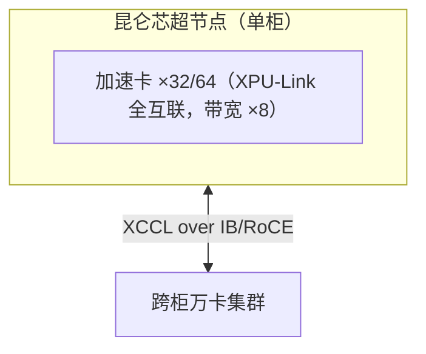

# 昆仑芯互联与组网

> 中文简称：昆仑芯互联

> **一句话理解**: 昆仑芯走的是「XPU-Link 卡间 + 单柜超节点 + 万卡集群」三级火箭——柜内全互联把带宽提升 8 倍，配合百度智能云的规模化部署，是国产超节点阵营里落地最快的一批。

---

## 1. 互联技术栈

| 层级 | 技术 | 说明 |
|---|---|---|
| 机内 | **XPU-Link** | 自研卡间互联，P800 OAM 8 卡模组的核心互联 |
| 超节点 | 柜级全互联 | 2025 年发布：单柜 32/64 卡，柜内卡间全互联通信，官方口径带宽提升高达 8 倍 |
| 机间 | IB/RoCE | 跨柜走标准高网；万卡级集群已部署 |
| 通信库 | **XCCL** | 昆仑芯集合通信库（NCCL 等价物），见 [[12_架构基建/08_网络/PPU与高网/06_集合通信库全景_2026|06 通信库全景]] |

---

## 2. P800 与超节点

| 维度 | 内容 |
|---|---|
| P800 | 第三代加速卡（XPU-R 架构路线），2024 年 3 月量产；支持 8 卡 OAM 模组（OCP 标准） |
| 虚拟化 | 支持硬件虚拟化，单卡可切 32 个 vXPU 实例（与 [[12_架构基建/08_网络/PPU与高网/04_MIG与高网交叉|04 MIG 与高网交叉]] 的切分语义对照） |
| 超节点（2025-04） | 突破单机 8 卡形态：单柜 32/64 卡、柜内全互联、带宽 ×8；「水电网三盲插」设计加快部署，集中供电省 40% 电源数量 |
| 规模 | 万卡级国产集群已落地（百度智能云口径）；2026 年启动科创板上市辅导 |

---

## 3. 组网逻辑

**图意**：昆仑芯的超节点选择「单柜」为基本单元（对比 NVL72 整机架液冷、CloudMatrix 384 多柜系统）——柜内是 XPU-Link 总线域，柜外立刻回到标准 IB/RoCE，对数据中心改造最友好（盲插+集中供电）。

---

## 4. 工程注意点

1. **vXPU 与互联**：虚拟化切分后的实例跨实例通信行为要看官方文档（切分与互联的互斥关系是通病，参见 MIG 的 P2P=No 教训）；
2. **HAMi 调度**：P800 已与 HAMi 落地「整卡 + vXPU」双模式调度，K8s 场景的算力切分方案可复用；
3. **XCCL 版本**：与 P800 固件/驱动绑定，升级需整体对齐。

---

## 5. 已知与未知

**有官方依据**：P800 2024 量产与 OAM 模组；单柜 32/64 卡全互联与带宽 ×8 口径；三盲插与省电 40%；万卡集群部署；vXPU 32 实例；XCCL 存在及其定位。

**公开资料不足**：XPU-Link 单链路带宽与拓扑细节；带宽「×8」的对照基线口径；XCCL 算法实现细节。

---

## 6. 面试速记

1. 昆仑芯超节点的记忆点：**单柜 32/64 卡 + 柜内带宽 ×8 + 盲插部署**；
2. XPU-Link 对标 NVLink、XCCL 对标 NCCL，命名规律是「X 换 N」；
3. 百度系（PaddlePaddle + 昆仑芯 + 百度智能云）是全栈自闭环样板。

---

## Related

- [[12_架构基建/08_网络/PPU与高网/README|PPU 与高网系列总纲]]
- [[12_架构基建/08_网络/PPU与高网/02_超节点技术_2026|02 超节点技术]]
- [[01_数学基础/10_AI硬件/03_Chinese_AI_Chips_深入分析|国产 AI 芯片深度解析]]

---

*Last updated: 2026-10-27*
