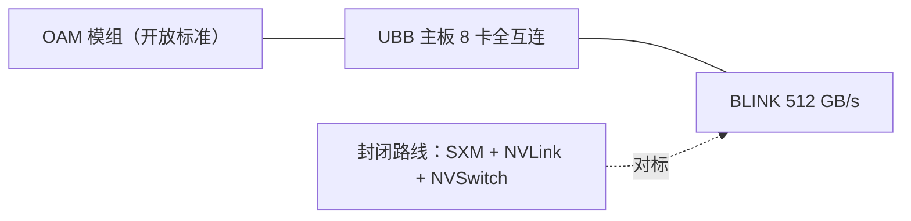

# 壁仞互联与组网

> 中文简称：壁仞互联

> **一句话理解**: BR100 在 2022 年用 BLINK 互连把国产卡的互联带宽纪录推到 512 GB/s——选 OAM 开放模组 + UBB 全互连的路线，是对 NVLink 封闭生态的标准答案。

---

## 1. BLINK 互连事实

| 维度 | 内容（公开口径） |
|---|---|
| 互连技术 | **BLINK**：壁仞首创的高速 GPU 互连，单卡互连带宽 **512 GB/s**（2022 发布口径） |
| 模组形态 | **OAM（OCP Accelerator Module）**：开放标准加速卡模组 |
| 机内拓扑 | 通用 **UBB 主板**上 8 卡点对点全互连（full-mesh 风格） |
| 主机通道 | PCIe 5.0 + **CXL** 协议，双向 128 GB/s |
| 芯片底座 | BR100：7nm、Chiplet、CoWoS 2.5D、770 亿晶体管 |

---

## 2. 路线解读：OAM + UBB 的开放牌

**图意**：壁仞没有复制 NVIDIA 的封闭模组体系，而是押注 OCP 开放标准——OAM/UBB 让不同厂家理论上可互换模组；BLINK 则是这套开放硬件里的自研互联内核。与寒武纪（OAM 形态）、昆仑芯（P800 OAM）同走开放路线。

---

## 3. 软件栈与生态

- **BIRENSUPA**：壁仞自研软件平台（驱动/运行时/编译/通信，对标 CUDA 全栈；公开细节有限）；
- 集合通信组件包含在 BIRENSUPA 体系内（定位见 [[12_架构基建/08_网络/PPU与高网/06_集合通信库全景_2026|06 通信库全景]] 的行业格局）；
- 量产与供应链受先进制程/封装限制影响较大，商用规模口径谨慎引用。

---

## 4. 组网注意点

1. **8 卡全互连域**：BLINK 域内 TP/EP 放置逻辑与 NVLink 机相同；跨域走标准以太/RoCE；
2. **CXL 通道**：BR100 时代即带 CXL，用于主机内存扩展/一致性场景——CXL 路线详见 [[概念/GPU/gpu-interconnect|GPU 互联技术]] 的趋势小节；
3. **口径纪律**：512 GB/s 是 2022 BR100 发布口径，后续产品（BR 世代迭代）以官方最新数据手册为准。

---

## 5. 已知与未知

**有公开依据**：BLINK 512 GB/s 单卡互连带宽与 8 卡全互连；OAM/UBB 形态；PCIe 5.0+CXL 128 GB/s；BR100 规格与 2022 发布。

**公开资料不足**：BLINK 协议细节与拓扑收敛比；新一代产品的互联规格；BIRENSUPA 通信库细节；规模化部署的公开案例。

---

## 6. 面试速记

1. 壁仞记忆点：**BLINK 512 GB/s + OAM/UBB 开放模组**；
2. 「OAM vs SXM」是开放与封闭生态之争的硬件投影——国产阵营多数选 OAM；
3. 谈壁仞必须提制程约束：设计能力与量产能力是两回事。

---

## Related

- [[12_架构基建/08_网络/PPU与高网/README|PPU 与高网系列总纲]]
- [[12_架构基建/08_网络/PPU与高网/09_寒武纪互联与组网|寒武纪互联与组网]]
- [[01_数学基础/10_AI硬件/03_Chinese_AI_Chips_深入分析|国产 AI 芯片深度解析]]

---

*Last updated: 2026-10-27*
