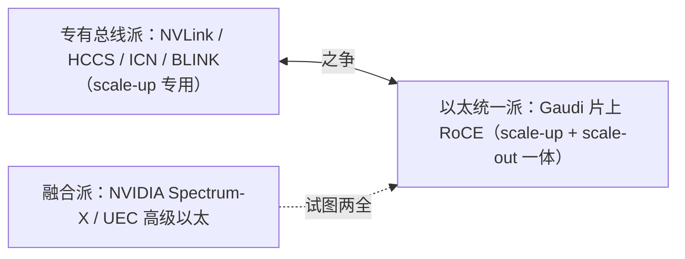

# Intel Gaudi 互联与组网

> 中文简称：Intel Gaudi 互联

> **一句话理解**: Gaudi 的互联哲学最「叛逆」：不造 NVLink，直接在芯片里塞 24 个 100GbE RoCEv2 网口——用标准以太网做 scale-up，赌开放网络终会赢专有总线。

---

## 1. 片上网络事实

| 维度 | Gaudi 2（2022） | Gaudi 3（2024） |
|---|---|---|
| 片上以太网 | 21×100GbE 集成网卡 | **24×100GbE** 集成网卡（RoCE v2） |
| 聚合口径 | 2.1 Tbps 级 | 2.4 Tbps 级（约 300 GB/s） |
| 主机通道 | PCIe Gen5 x16 | PCIe Gen5 x16 |
| 通信库 | oneCCL / SynapseAI 栈 | 同左 |

要点：Gaudi 把 RDMA 网卡集成进加速器本体，scale-up（机内多卡）与 scale-out（跨机）**统一走以太 RoCE**——一张技术栈吃两层，运维心智成本低；代价是机内带宽低于 NVLink/UALink 级专有互联。

---

## 2. 路线解读：以太一统的旗手

**图意**：Gaudi 是「以太统一派」的硬件实证。如果超以太网联盟（UEC）与 UALink 1.0（复用以太物理层）的路线胜出，Gaudi 的架构选择会被重新评价。

---

## 3. 软件栈与现状

- **SynapseAI + oneCCL**：Intel 的训练栈与集合通信库（oneAPI 体系），见 [[12_架构基建/08_网络/PPU与高网/06_集合通信库全景_2026|06 通信库全景]]；
- 性价比叙事：Gaudi 3 以「H100 级性能、更低价格」定位，部分云厂商（如 IBM Cloud）部署；
- **不确定性**：Intel 对 Gaudi 后继（Jaguar Shores 方向转型）的公开口径反复——引用产品路线图时注明「截至 2026-10 的公开信息」。

---

## 4. 组网要点

1. 机内多卡即标准 RoCE 交换——交换机选型/拥塞配置（PFC/ECN）从可选变必答；
2. 无专有总线域的概念，TP 放置按以太拓扑（轨优化）规划，参考 [[12_架构基建/08_网络/01_AI_网络_基础|AI 网络基础]]；
3. 集成网卡排障走标准 RDMA 工具链（perftest/ibstat），见 [[12_架构基建/08_网络/PPU与高网/05_高网性能测量方法_2026|05 测量方法]]。

---

## 5. 已知与未知

**有公开依据**：21/24×100GbE 片上 RoCE v2；PCIe Gen5；oneCCL/SynapseAI 栈。

**公开资料不足/变动**：后继产品路线；大规模部署的公开拓扑案例；UEC 采纳进度。

---

## 6. 面试速记

1. Gaudi 记忆点：**片上 24×100GbE RoCE——「网卡即互联」**；
2. 它代表了 scale-up 的以太网化假说，与 UALink/UEC 大方向共振；
3. 谈 Intel AI 硬件必须区分「架构有想法」与「路线图有变数」两件事。

---

## Related

- [[12_架构基建/08_网络/PPU与高网/README|PPU 与高网系列总纲]]
- [[12_架构基建/08_网络/06_RDMA_and_RoCE_for_AI|RDMA 与 RoCE 在 AI 集群中的应用]]
- [[12_架构基建/08_网络/PPU与高网/07_NVIDIA_互联与组网|NVIDIA 互联与组网]]

---

*Last updated: 2026-10-27*
