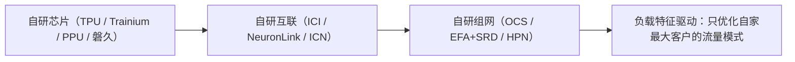

# 云厂商自研芯片互联：TPU 与 NeuronLink

> 中文简称：TPU 与 NeuronLink

> **一句话理解**: Google 和 AWS 证明了另一条路——不为通用市场造卡，只为自家负载造网：TPU 用 ICI+OCS 光交换把拓扑变成「可软件重配的 3D 环面」，AWS 用 NeuronLink+EFA 把训练芯片直连成超节点。

---

## 1. Google TPU：ICI + OCS

| 维度 | 内容 |
|---|---|
| 片间互联 | **ICI**（Inter-Chip Interconnect）：TPU 间高速直连，构成 2D/3D 环面（torus）拓扑 |
| 光交换 | **OCS**（Optical Circuit Switch，Apollo/Palomar 系）：Pod 内用光路交换重构拓扑——训练任务启动时把环面「接成」任务需要的形状 |
| 意义 | 电气 packet 交换机的拥塞/缓存问题被光路交换绕开；拓扑即软件配置项 |
| 机间 | 跨 Pod 走数据中心网络（Jupiter 体系） |

- TPU 世代的详细规格与演进见 [[01_数学基础/10_AI硬件/04_Google_TPU_深入分析|Google TPU 深入分析]]；
- ICI 具体每代带宽口径变化快，引用以 Google 官方文档为准。

### 对行业的启示

OCS 是「用光路交换做 scale-up 域重构」的唯一大规模生产案例：**拓扑不再焊死在机房里**。对高网选型的启发：当任务形态多变（训练切片大小不一）时，可重构拓扑的长期价值可能超过固定拓扑的峰值带宽。

---

## 2. AWS：NeuronLink + EFA

| 维度 | 内容 |
|---|---|
| 片间/卡间 | **NeuronLink**：Trainium 芯片间高速互联，Trn2 实例 16 芯片、Trn2 UltraServer 64 芯片规模的互联域 |
| 机间 | **EFA**（Elastic Fabric Adapter）：AWS 自研网卡/端点，跑在 Nitro 体系上，提供 RDMA 语义与自定义低延迟协议（SRD——多路径可靠传输） |
| 软件栈 | Neuron SDK；集合通信走 EFA 上的库（AWS 定制 NCCL 等价路径） |

- EFA 的 SRD 多路径设计与阿里云 eRDMA「在通用网上做可靠 RDMA」异曲同工（对照 [[12_架构基建/08_网络/PPU与高网/03_eRDMA_深入分析|eRDMA 深入分析]]）；
- Trainium 世代规格随 re:Invent 发布演进快，以 AWS 官方口径为准。

---

## 3. 云自研互联的共同哲学

**图意**：从芯片到网络全栈自研的目的不是每个单点都赢过 NVIDIA/NVIDIA 网络，而是**消除层间接缝**——接口不兼容、协议转换、跨层调优的税全部免掉。阿里 PPU+HPN+磐久（[[01_数学基础/10_AI硬件/09_PPU_High_Performance_Network|PPU 高性能网络与 ICN 互联]]）正是这一哲学的国内版本。

---

## 4. 已知与未知

**有公开依据**：TPU ICI 环面 + OCS 光交换架构；Trn2/UltraServer 的 16/64 芯片 NeuronLink 域；EFA 的 RDMA/SRD 定位。

**公开资料不足**：ICI 逐代带宽的官方完整表格；OCS 重构时延；EFA 与标准 RDMA 的性能差异数据。

---

## 5. 面试速记

1. TPU 互联一句话：**ICI 织环面，OCS 换拓扑**；
2. AWS 互联一句话：**NeuronLink 管片间超节点，EFA/SRD 管机间可靠多路径**；
3. 云自研的本质：**消灭跨层接缝**——这也是回答「为什么大厂都要自研芯片+网络」的万能框架。

---

## Related

- [[12_架构基建/08_网络/PPU与高网/README|PPU 与高网系列总纲]]
- [[01_数学基础/10_AI硬件/04_Google_TPU_深入分析|Google TPU 深入分析]]
- [[12_架构基建/08_网络/PPU与高网/03_eRDMA_深入分析|eRDMA 深入分析]]

---

*Last updated: 2026-10-27*
