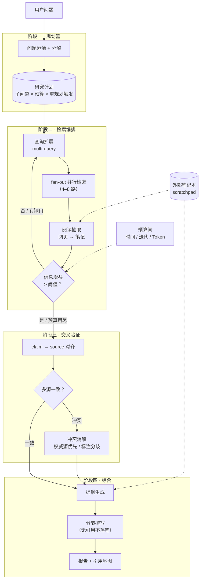

# Deep Research 架构拆解 · 四阶段流水线

> 中文简称：Deep Research 架构拆解

> **一句话理解**: 把 Deep Research 拆成「规划 → 并行检索 → 交叉验证 → 综合」四段流水线，每段有独立的职责边界、可调参数和专属失败模式——调优时对号入座，不要笼统说「模型不行」。

---

## 1. 全景图



三个贯穿性设计决定系统成败，先记住再看细节：**笔记外置**（阅读痕迹写入 scratchpad，窗口内只留笔记与计划状态，防上下文爆仓）、**增益闸**（新信息边际贡献低于阈值即停，防过度检索）、**预算闸**（时间/迭代/Token 三重硬上限，防无限循环）。

---

## 2. 阶段一 · 规划器

**职责**：把一个模糊的大问题变成一份结构化研究计划。规划质量决定整条流水线的上限——检索阶段只是执行，方向错了后面全白跑。

```python
def plan(question: str) -> ResearchPlan:
    clar = clarify(question, max_questions=2)      # 歧义消解：范围/时间窗/口径不明先反问
    subs = decompose(question, max_subs=8)         # 子问题拆解：相互独立、合起来 MECE 覆盖
    return ResearchPlan(
        goal=question,
        subtasks=[SubTask(q, seed_queries=suggest(q)) for q in subs],
        budget=Budget(time_min=10, max_iter=15, max_tokens=600_000),
        replan_triggers=[                          # 触发重规划而非硬撑
            "关键子问题连续 2 轮检索失败",
            "发现计划外的重要新维度",
        ],
    )
```

| 工程参数 | 推荐区间 | 说明 |
|----------|---------|------|
| 子问题数 | 3–8 个 | 超过 8 个后期漂移概率显著上升；宁可两轮计划也不要一张巨表 |
| 澄清问题数 | ≤ 2 个 | 只问阻塞性歧义（时间范围、地域、口径），非阻塞的自行假设并声明 |
| 重规划次数上限 | 2 次 | 每次重规划必须回锚原始问题（re-anchor），防止计划本身漂移 |
| 优先级排序 | 必要（先做 Blocking 的子问题） | 让前置子问题的结论参与后续子问题的查询生成 |

**专属失败模式**：过度分解（20 个子问题 → 报告变成拼凑清单）；计划僵化（环境已证明方向错了仍硬撑到预算耗尽）。

---

## 3. 阶段二 · 检索编排

**职责**：执行研究计划——把每个子问题扩成多路查询、并行检索、带着问题读网页、写进笔记，并决定「还查不查」。

```python
async def orchestrate(plan: ResearchPlan) -> Notebook:
    notebook = Notebook()
    for it in range(plan.budget.max_iter):
        open_tasks = plan.open_subtasks()                    # 未充分回答的子问题
        queries = expand(open_tasks, k=4)                    # 每子任务扩 4 路查询（同义改写/角度切换）
        results = await gather(*[search(q) for q in queries])  # 并行度 4–8，受 API 限速约束
        for page in dedupe(results):                         # URL + 内容指纹双重去重
            notes = extract(page, focus=plan)                # 带着问题读：只抽与子任务相关的片段
            notebook.absorb(notes)                           # 写入 scratchpad，返回信息增益
        if notebook.gain < GAIN_THETA or plan.all_satisfied():
            break                                            # 增益饱和 → 该出循环了
        plan.revise_if_triggered()                           # 命中 replan_triggers 才重规划
    return notebook
```

### 3.1 上下文预算分配（128K 窗口经验值）

| 区块 | 占比 | 说明 |
|------|------|------|
| 系统提示 + 研究计划 | ~10% | 计划常驻窗口——这是防漂移的锚 |
| 笔记本摘录 | 50–60% | 只放结构化笔记（事实+来源编号），不放原文 |
| 本轮候选原文片段 | 20–30% | 仅当轮待抽取的原始内容，用完即弃 |
| 输出余量 | ~10% | 笔记更新 + 反思输出 |

### 3.2 「还查不查」的双重闸门

- **增益闸**：本轮新笔记占已有笔记比例 < 10%（经验值），或新引用域名与已有重合度 > 80%，判定饱和。
- **预算闸**：任一硬上限（时间/迭代/Token）触顶即停，带着已有材料进综合——**宁可报告单薄，不可循环失控**。

**专属失败模式**：信源单一化（缓解：给每个子问题设「至少 2 个独立域名」配额）；查询同质化（缓解：扩展时强制切换角度——数据/案例/反方观点）。

---

## 4. 阶段三 · 交叉验证

**职责**：把笔记变成「可引用的证据」——每条论断挂上来源，冲突被显式处理而不是悄悄选边。

```python
def verify(notebook: Notebook) -> Evidence:
    claims = atomicize(notebook.notes)                # 拆成原子论断（一句一 claim）
    evidence = Evidence()
    for c in claims:
        c.sources = notebook.backref(c)               # claim → source 映射，综合阶段强制使用
        if len(c.sources) >= 2 and divergent(c.sources):
            c.status = resolve_conflict(c)            # 冲突消解（见下表）
        elif len(c.sources) == 1 and c.load == "high":  # 高载荷单源论断 → 降级或补检
            c.status = "needs_more_sources"
    return evidence
```

冲突消解四策略：

| 冲突类型 | 策略 |
|----------|------|
| 数值 / 事实 | 取权威源（官方文档 > 原始论文 > 主流媒体），并在报告中标注分歧值 |
| 时间性差异 | 取最新数据并显式注明「截至日期」，旧数据不删除、作对照 |
| 观点 / 预测 | 并列呈现，标注各信源立场与利益相关性 |
| 无法判定 | 明写「存在争议，证据如下」——**显式存疑好过静默选边** |

**专属失败模式**：引用幻觉（引用与论断脱节——根治手段是综合阶段只允许从 evidence 结构化取引用，禁止模型凭记忆写链接）。

---

## 5. 阶段四 · 综合

**职责**：把证据集变成结构化长报告——先提纲、再分节、引用从 evidence 回填。

**分节生成 vs 一次生成**：

| 维度 | 一次生成 | 提纲 + 分节生成 |
|------|---------|----------------|
| 全文连贯性 | 较好 | 靠提纲与「前情摘要」衔接 |
| 引用准确性 | 易凭记忆出错 | 每节只挂本节用到的 evidence，准确率高 |
| 长度上限 | 受单次输出限制 | 可产出数千字长文 |
| 成本 | 一次长输出 | 多次调用，成本略高 |

生产系统几乎都选**分节生成**：先由规划 + 笔记生成全文提纲，每节撰写时注入「提纲 + 本节证据子集 + 已写各节的 100 字摘要」，并施加约束——

```text
你正在撰写研究报告的「{section}」一节。
规则：
1. 每个事实性论断必须挂 [n] 形式的引用编号，n 只能取自本节证据集的编号；
2. 证据集没有支撑的观点，写「本文分析认为」并给出推理链，不得伪装成引用事实；
3. 与其他章节重复的内容，引用编号指向已写章节，不重复论证。
```

**专属失败模式**：拼凑感（节与节之间风格断裂——缓解：提纲阶段统一各节的核心论点句）；长度失衡（重要问题篇幅不足——缓解：提纲阶段按子问题优先级分配篇幅预算）。

---

## 6. 全局工程参数速查表

| 参数 | 推荐区间 | 过小的后果 | 过大的后果 |
|------|---------|-----------|-----------|
| 子问题数 | 3–8 | 覆盖不全 | 长任务漂移 |
| 并行检索路数 | 4–8 | 墙钟时间不可接受 | 触发限速、结果相互覆盖 |
| 迭代上限 | 10–15 轮 | 研究不充分 | 成本失控 |
| 时间预算 | 交互式 5–15 分钟 / 离线小时级 | — | 用户流失或资源闲置 |
| 信息增益饱和阈值 | 新增 < 10% 即停 | 过度检索 | 过早收敛、报告单薄 |
| 引用密度 | 每千字 ≥ 5 个可追溯引用 | 报告可信度崩塌 | — |
| 独立域名配额 | 每子问题 ≥ 2 | 信源单一化 | — |

---

## 7. 测试时计算视角

Deep Research 与 o 系列 / R1 类推理模型是**测试时计算的两条 spending 路线**：

| 维度 | 推理模型（长思考） | Deep Research（长循环） |
|------|-------------------|------------------------|
| 算力花在哪 | 模型内部——更长的思维链 | 模型外部——更多轮真实检索与阅读 |
| 信息来源 | 参数知识（训练截止为止） | 世界的实时状态（网页、数据库） |
| 可验证性 | 推理链可审但事实不可查证 | 引用地图可直接回查信源 |
| 适合 | 数学/代码等封闭问题 | 开放的、需要新鲜信息的研究问题 |

两者正在合流：推理模型负责循环内的规划与反思（见 [[15_智能体/17_Agent应用/02_Deep_Research_Agent|先导页]] 训练范式三阶段），Deep Research 外壳负责与世界交互。深入推理侧的算力账见 [[05_大模型/08_推理模型/08_Test_Time_算力_2026|Test-Time 算力扩展]]。

---

## Related

- [[14_RAG系统/08_Deep_Research/01_Deep_Research_全景_2026|Deep Research 全景 2026]]
- [[14_RAG系统/08_Deep_Research/03_开源实现对比与最小复现|开源实现对比与最小复现]]
- [[概念/RAG/rag-systems|RAG 检索增强生成]]
- [[概念/RAG/agentic-rag-2|Agentic RAG]]
- [[概念/Agent/agent-planning|Agent 规划]]
- [[概念/Agent/tool-use|Tool Use]]
- [[05_大模型/08_推理模型/08_Test_Time_算力_2026|Test-Time 算力扩展]]

---

*Last updated: 2026-11-03*
