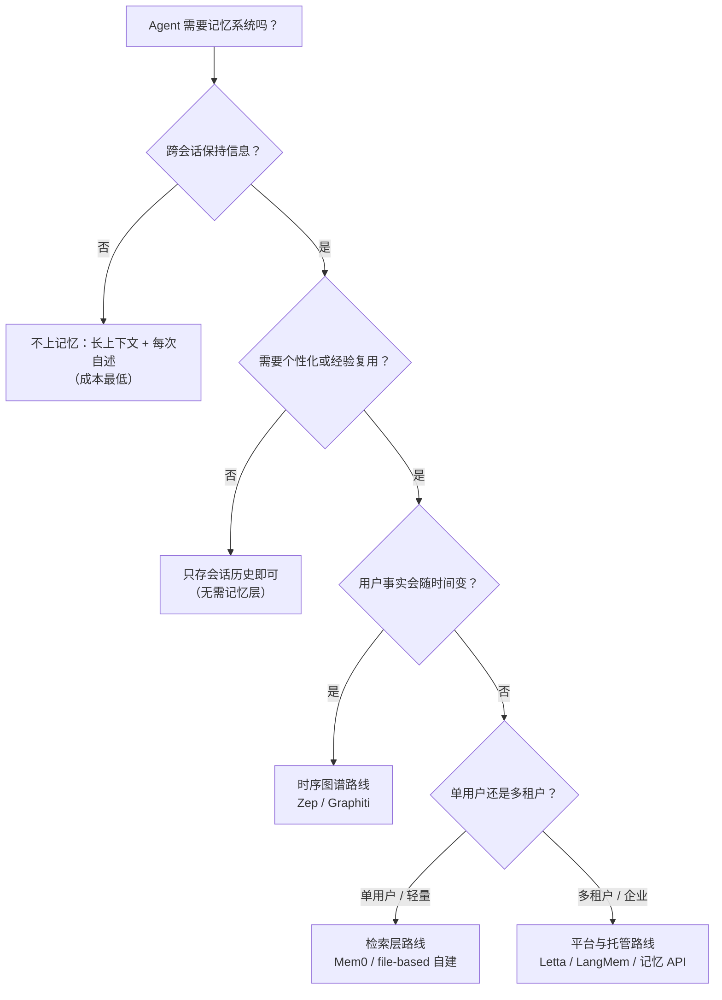

# Agent 记忆系统总览 · 选型决策树

> 中文简称：Agent 记忆系统总览

> **一句话理解**: 本页是记忆专题的决策入口——先回答「要不要上记忆系统」（大多数项目其实不需要），再回答「要哪种」（检索层 / 时序图谱 / OS 式分层 / 平台原语），然后按需跳转目录里的深度页。

---

## 1. 第一问：要不要记忆系统？

决策树三层：**跨会话是记忆的入场券**（会话内的问题靠上下文工程解决，见 [[概念/LLM/context-engineering|上下文工程]]）；**个性化决定值不值得建**；**事实时变性决定路线**——这是 2026 才被广泛认识的关键分叉（纯向量记忆处理不了「用户搬家了」这类事实更新）。

### 五条「不需要记忆系统」的反模式

1. **上下文装得下**——单会话任务，128K 窗口足够，记忆层是纯开销。
2. **用户每次自述**——开放式问答场景，没有「上次」可言。
3. **知识是静态文档**——那是 RAG 的领地（[[概念/RAG/rag-systems|RAG]]），记忆系统管的是「关于用户与 Agent 自身的动态事实」。
4. **高频低价值对话**——每次写入 + 检索的 LLM 调用成本超过个性化收益。
5. **合规禁止留存**——数据不能落盘就谈不上记忆，先解决合规再谈架构。

---

## 2. 第二问：要哪种记忆？

三类记忆 × 两场景的实现矩阵（类型学详解见 [[概念/Agent/agent-memory-systems|Agent 记忆系统概念卡]]）：

| 记忆类型 | 个人助手（单用户） | 多租户平台 |
|----------|-------------------|-----------|
| **工作记忆**（当前任务） | 上下文窗口 + scratchpad 文件 | 上下文窗口 + 会话状态服务 |
| **情景记忆**（发生过什么） | 本地 SQLite / 会话日志 | 分区存储（按 user_id/tenant 隔离） |
| **语义记忆**（事实与偏好） | 本地向量库（Qdrant/Chroma）或 file-based | 托管向量库 + 冲突消解层（时序图谱可选） |
| **程序记忆**（怎么做） | 技能库 / 工具配置（[[15_智能体/05_Agent技能/README|Agent 技能]]） | 技能注册中心 + 权限门 |

---

## 3. 本目录分工导航

| 页面 | 定位 | 什么时候读 |
|------|------|-----------|
| [[15_智能体/06_记忆基础设施/00_记忆系统总览_决策树\|00 本页]] | 决策入口：要不要 / 要哪种 | 项目启动时 |
| [[15_智能体/06_记忆基础设施/01_Agent_Memory_系统_2026\|01 记忆系统 2026]] | 原理与架构：MemGPT 分层、检索策略、隐私、**2026-10 前沿增量**（平台记忆原语化 / A-MEM / MCP 记忆） | 设计记忆层前 |
| [[15_智能体/06_记忆基础设施/02_Agent_Memory_技术\|02 记忆技术指南]] | 工程操作：**写入策略 / 更新与冲突消解 / 程序记忆** | 写代码前 |
| [[15_智能体/06_记忆基础设施/04_RAG_记忆基础设施_工具\|04 RAG 与工具栈]] | RAG / 记忆 / 基础设施工具全景（LlamaIndex / Dify / 向量库） | 选工具时 |
| [[15_智能体/06_记忆基础设施/05_synthesis_memory_systems\|05 记忆体系全景]] | 从 KV Cache 到长期知识图谱的系统视角 | 建立全局认知时 |
| [[15_智能体/06_记忆基础设施/06_记忆产品选型对比_2026\|06 产品选型 2026]] | Mem0 / Zep / Letta / LangMem / 平台原语 / 自建 对比与结论 | **选型时（含本地千问办公 Agent 结论）** |
| [[15_智能体/06_记忆基础设施/07_压缩_遗忘_分层策略\|07 压缩与遗忘]] | 记忆卫生学：压缩 / 摘要 / 反思 / 遗忘四动作与分层升降级 | 记忆库膨胀后 |
| [[15_智能体/06_记忆基础设施/08_面试快问快答_20题\|08 快答 20 题]] | 面试冲刺 | 考前 |

---

## 4. 选型速断

- 用户事实会变（搬家/换偏好/改口径）→ **时序图谱**（[[15_智能体/06_记忆基础设施/06_记忆产品选型对比_2026|06 页 §决策轴一]]）。
- 长对话塞不下、需要 OS 式分页 → **Letta**。
- LangGraph 生态内 → **LangMem**。
- 只要「记住用户」的检索层，要轻 → **Mem0** 或 file-based 自建。
- 不想自建任何层 → **平台原语**（Claude Memory Tool / OpenAI Memory），代价是锁定。
- 单用户本地部署（隐私优先）→ 见 06 页 §本地千问办公 Agent 结论。

---

## Related

- [[概念/Agent/agent-memory-systems|Agent 记忆系统（概念卡）]]
- [[概念/LLM/context-engineering|上下文工程]]
- [[15_智能体/20_Agentic_Infra/04_本地千问办公Agent实战|本地千问办公 Agent 实战（记忆层落地场景）]]
- [[15_智能体/README|Agent 生产部署（章节）]]

---

*Last updated: 2026-11-03*
