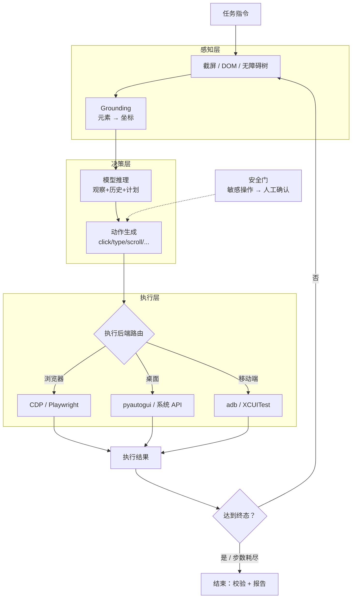

# Computer Use 技术拆解 · 感知 / 决策 / 执行

> 中文简称：Computer Use 技术拆解

> **一句话理解**: Computer Use 的每一轮都是「截图感知 → 模型决策 → 动作执行 → 截图反馈」的循环——工程优化点藏在表征选择、grounding 精度、动作抽象和纠错策略四处，本页逐一拆开。

---

## 1. 全景循环



三个关键设计：**表征路由**（结构化可用时优先，像素兜底）、**安全门前置**（敏感动作不进执行层）、**每步截图回填**（模型看到自己操作后的世界，是纠错的物理基础）。

---

## 2. 感知层

### 2.1 三种表征对比

| 表征 | 信息密度 | token 成本/步 | grounding 精度 | 覆盖面 |
|------|---------|--------------|---------------|--------|
| 纯截图 | 低（像素） | 1–5K token | 依赖模型视觉（小元素易错） | 100% |
| 截图 + Set-of-Mark | 中（截图+编号框） | 2–6K | 高（模型引用编号而非算坐标） | 100% |
| DOM / 无障碍树 | 高（结构化） | 0.5–2K | 最高（直接拿元素句柄） | Web / 完备应用 |

### 2.2 grounding：从「那个按钮」到「(x, y)」

这是像素路线的第一精度瓶颈，四个已知难点与对策：

| 难点 | 现象 | 对策 |
|------|------|------|
| 小元素（<50px） | 点到相邻元素 | SoM 标注 / 两级定位（先区域后元素）/ zoom 后再点 |
| 分辨率缩放 | 截图坐标 ≠ 屏幕坐标（Retina 2x） | 统一坐标系，执行层做缩放换算 |
| 动态 UI | 弹窗/加载态让定位失效 | 动作前重截屏；加载等待原语（wait） |
| 文本输入定位 | 点进输入框后光标漂移 | 点完立即截图确认焦点 |

---

## 3. 决策层

### 3.1 动作空间

业界事实标准收敛在 Anthropic `computer_20241022` 工具形状上：`screenshot` / `left_click` / `right_click` / `double_click` / `type` / `key`（快捷键）/ `scroll` / `cursor_position` / `wait` / `zoom`。设计原则：**动作空间越小越好**——每个动作都是模型的一种出错方式，能用 `type` 的不要让模型逐字 `key`。

### 3.2 层级策略与轨迹格式

两套主流轨迹数据格式（训练数据与执行日志的通用语言）：

- **Anthropic 形状**：tool_use(content=action, id) ↔ tool_result(screenshot)，纯工具调用视角；
- **OpenAI CUA 形状**：`pending_safety_check` + `reasoning` 字段显式带出模型思考与安全检查。

共性结构是三元组序列：`(观察, 思考, 动作)`——自建系统建议直接兼容 Anthropic 形状（事实标准），另存结构化日志供 [[15_智能体/21_Computer_Use/04_评测与失败模式|评测]] 回放。

### 3.3 模型选择

按任务复杂度路由：简单任务（单步定位/填写）用小模型，复杂多步任务用旗舰——截图 token 是固定开销，模型档位是最大可变成本（详见概念卡成本账）。

---

## 4. 执行层

### 4.1 多后端抽象

```python
class ActionBackend(Protocol):
    async def click(self, x: int, y: int, button: str = "left"): ...
    async def type_text(self, text: str): ...
    async def key(self, combo: str): ...          # "ctrl+s"
    async def scroll(self, dx: int, dy: int): ...
    async def screenshot(self, region=None) -> Image: ...

# 同一动作空间，三个后端
backends = {
    "browser": PlaywrightBackend(),      # CDP：快、可隔离、元素句柄可得
    "desktop": PyAutoGUIBackend(),       # 系统 API：通用但爆炸半径大
    "mobile":  ADBBackend(),             # 设备端
}
router = BackendRouter(backends)          # 按目标应用路由（见安全页白名单）
```

设计要点：**坐标换算集中在执行层**（感知层永远输出逻辑坐标）、**每个后端独立可沙箱**（浏览器进沙箱容器，桌面进受限账户——见 [[15_智能体/21_Computer_Use/03_权限与安全模型|03 安全模型]]）。

### 4.2 反馈与纠错

每步执行后截屏回填（`tool_result` 带截图），模型据此后验校验——「点了但没反应」「弹窗挡住了」都靠这一步发现。三层纠错策略：

1. **步内重试**（同动作重发，限 1–2 次，防死循环）；
2. **回退**（快捷键 Esc / Ctrl+Z 恢复已知状态）；
3. **升级人工**（连续失败 N 步或触发安全门 → 暂停等确认）。

---

## 5. 工程参数速查表

| 参数 | 推荐区间 | 说明 |
|------|---------|------|
| 截图分辨率 | 1280–1920 宽 | 过大 token 翻倍，过小小元素不可辨 |
| 最大步数 | 30–50 步/任务 | 长任务漂移的硬闸 |
| 单动作节流 | 200–500ms | 给 UI 渲染留时间，防动作丢失 |
| 截图预算 | 每步 1–5K token | 复杂任务全程 $1+ 量级（见概念卡成本账） |
| 步内重试 | ≤ 2 次 | 超过即升级纠错 |
| 安全门动作清单 | 支付/删除/发送/授权 | 一律人工确认 |

---

## Related

- [[15_智能体/21_Computer_Use/01_GUI_Agent_Computer_Use_全景_2026|GUI Agent 与 Computer Use 全景 2026]]
- [[15_智能体/21_Computer_Use/03_权限与安全模型|权限与安全模型]]
- [[15_智能体/21_Computer_Use/04_评测与失败模式|评测与失败模式]]
- [[概念/Agent/computer-use|Computer Use 概念卡（工具形状与产品对比）]]
- [[15_智能体/17_Agent应用/01_Computer_Use_Agent|Computer Use Agent（RPA 与企业自动化视角）]]
- [[21_面试岗位/28_Agent_Runtime工程师/13_Sandbox_快问快答_50题|Sandbox 快问快答 50 题（执行隔离）]]

---

*Last updated: 2026-11-04*
